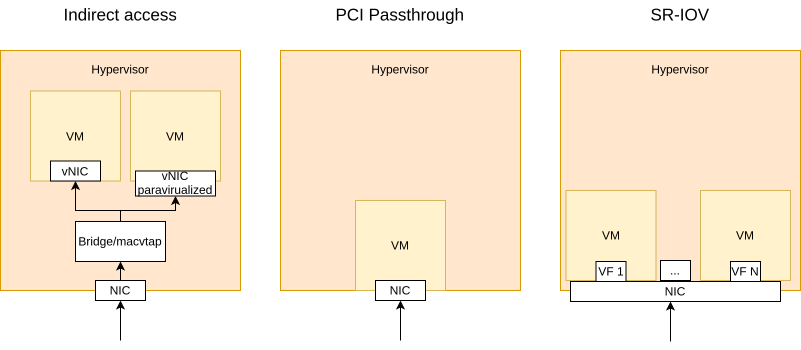

[Deploy your application on SEAPATH](../../../Deploy%20your%20application%20on%20SEAPATH.md) > [Deploying virtual machines](../../Deploying%20virtual%20machines.md) > [Virtual machines deployment](../Virtual%20machines%20deployment.md)

# Connect a virtual machine to the network

There are three primary methods for connecting virtual machines to physical network interfaces:

**Virtualized network interfaces (indirect access):**

This approach uses emulated or paravirtualized network drivers within the VM.  
Interfaces can be

- Fully emulated and mimic standard physical NICs (such as e1000)
- Paravirtualized like virtio drivers that are aware they're virtualized, enabling performance improvements

Data flows from the physical NIC through a hypervisor backend (Linux bridge, OVS bridge or macvtap ) then via vhost/vhostuser into the VM's network driver. This flexible method supports various network configurations.

**PCI passthrough (direct access):**

The VM gains exclusive control of an entire physical network card, with data processed directly by the VM and completely bypassing the hypervisor for near-native performance. This method has two significant limitation : The entire physical NIC is dedicated to one VM, thus is unavailable to other VMs or the hypervisor.

**SR-IOV (hardware-assisted virtualization):**

Single Root I/O Virtualization is a PCI Express extended capability enabling one physical NIC to appear as multiple virtual functions. Multiple VMs can simultaneously share the same physical NIC with near-native performance, each accessing a dedicated virtual function. This is the highest-performance method, but it requires a compatible NIC.


> [!NOTE]
> For a time-critical virtual machine, the Sampled Values and GOOSE messages should be received on an interface using direct access (PCI Passthrough or SR-IOV). Indirect access method is not fast enough. The rest of the data can transit along all connection types.

## Connect a virtual machine to a Linux bridge

To connect a VM to a Linux bridge, the bridge must first be created on the hypervisor.

By default, SEAPATH network contains one bridge named “br0” for administration. If you wish to create more bridges, refer to [Network configuration and deployment](../../../SEAPATH%20fundamentals/Hypervisor%20network/Network%20configuration%20and%20deployment.md)

For a hand-written VM XML, connect to a bridge using <https://libvirt.org/formatnetwork.html#using-an-existing-host-bridge>

For the `guest.xml.j2`, use the `bridges` variable and give the name of the bridge and the MAC address Multiple connections can be provided.

```java
bridges:
  - name: "br0"
    mac_address: "52:54:00:e4:ff:02"
```

## Connect a virtual machine to an OVS bridge

To connect a VM to an OVS bridge, the bridge must first be created on the hypervisor. Refer to [Use Open vSwitch bridges on SEAPATH](../../../SEAPATH%20fundamentals/Hypervisor%20network/Use%20Open%20vSwitch%20bridges%20on%20SEAPATH.md)

The connection of a VM to the OVS bridge is configured inside the Libvirt XML file.

The VM can connect via a tap interface on the bridge. This requires having the tap interface created along with the bridge.

The VM can also connect directly to the bridge. In that case, the creation and configuration of the tap interface are handled by Libvirt.

### Connect to a tap interface

A VM interface of virtio type must be created with the target being the tap interface. Refer to the [Libvirt documentation](https://libvirt.org/formatdomain.html#generic-ethernet-connection).

If you are using the `guest.xml.j2` template provided by SEAPATH, you can use the `ovs` variable in your VM inventory. See role documentation of [deploy\_vms\_standalone](https://galaxy.ansible.com/ui/repo/published/seapath/ansible/content/role/deploy_vms_standalone/) or [deploy\_vms\_cluster](https://galaxy.ansible.com/ui/repo/published/seapath/ansible/content/role/deploy_vms_cluster/).

### Connect directly to the bridge

The tap interface can be created directly by Libvirt. This is configured the same way for a standard Linux bridge as for an OVS bridge. Refer to the [Libvirt documentation](https://libvirt.org/formatdomain.html#bridge-to-lan).

If you are using the `guest.xml.j2` template provided by SEAPATH, you can use the `bridges` variable in your VM inventory.

```java
bridges:
- name: "ovsbr"
  mac_address: "58:47:ca:72:49:51"
  type: openvswitch
  vlan: 100 # (Optional) Put the tap interface on a VLAN
```

See role documentation of [deploy\_vms\_standalone](https://galaxy.ansible.com/ui/repo/published/seapath/ansible/content/role/deploy_vms_standalone/) or [deploy\_vms\_cluster](https://galaxy.ansible.com/ui/repo/published/seapath/ansible/content/role/deploy_vms_cluster/) for more information.

## Connect a virtual machine using PCI Passthrough

In a hand written Libvirt XML file, refer to the Libvirt documentation on the `hostdev` keyword: <https://libvirt.org/formatnetwork.html#connectivity>

With the `guest.xml.j2` Libvirt XML file, you can use the `pci_passthrough` variable. See role documentation of [deploy\_vms\_standalone](https://galaxy.ansible.com/ui/repo/published/seapath/ansible/content/role/deploy_vms_standalone/) or [deploy\_vms\_cluster](https://galaxy.ansible.com/ui/repo/published/seapath/ansible/content/role/deploy_vms_cluster/) for more information.

```java
VM:
# ... other VM settings
  pci_passthrough:
    - domain: 0
      bus: 1
      slot: 0
      function: 1
```

> [!NOTE]
> PCI Passthrough does not require specific NIC compatibility. However, the NIC must be connected to the hypervisor using a PCI bus.  
> This feature is not compatible with USB-ethernet adapters

### Get the PCI address of an interface

Connecting with PCI Passthrough necessitates having the PCI address of the network card. This address must then be written as source in the Libvirt XML file, or as a variable in the VM inventory (when using `guest.xml.j2`).

To get the PCI address of an interface, you can use this command on a SEAPATH hypervisor:

```java
for interface in /sys/class/net/e* ; do echo "$(basename $interface): $(basename $(realpath ${interface}/device))" ; done
```

Each interface will be displayed on a line with the information formatted as `domain:bus:slot:function`  
If the information is not correctly formatted, the interface is not connected with a PCI bus, therefore does not support PCI Passthrough.

## Connect a virtual machine with SR-IOV

Connecting a VM to SR-IOV necessitates manipulating the SR-IOV configuration of the network card. All informations is on [Use SR-IOV NIC on SEAPATH](../../../SEAPATH%20fundamentals/Hypervisor%20network/Use%20SR-IOV%20NIC%20on%20SEAPATH.md)

## Connect a virtual machine using MacVTap

MacVTap enables a direct connection between a virtual machine and a physical network interface, with traffic handled in software by the hypervisor. It supports several modes, most notably "bridge", "vepa", "private", and "passthrough", which determine how VM-to-VM communication is handled on the same physical interface.  
The `TrustGuestRxFilters` attribute is a separate configuration option that controls whether the guest is allowed to set receive filters on the interface. For complete details on configuration and behavior, refer to the official Libvirt documentation: <https://libvirt.org/formatnetwork.html#connectivity>

> [!NOTE]
> The `guest.xml.j2` file does not provide a way to connect through MacVTap. You must write your own Libvirt XML file.

### Modify interface IRQ priority

When sending time-critical data on a MacVTap interface, it may be necessary to isolate the IRQ of the interface on specific cores. Most of the time, the best solution is to put this IRQ on the same core that is running the management thread of the VM (See [Real time virtual machine configuration](Real%20time%20virtual%20machine%20configuration.md) )

This can be done using the `configure_nic_affinity` role. More information is in the [role documentation](https://galaxy.ansible.com/ui/repo/published/seapath/ansible/content/role/configure_nic_irq_affinity/).

```java
nics_affinity:
  - "eth0": "3-4"
  - "eth1": "9"
  - "eth2": "7,10-13"
```

## QEMU hook

TODO : explain SEAPATH QEMU hooks once merged

## Troubleshooting

### Virtual machine don’t start with PCI Passthrough

On some servers, several interfaces are part of the same IOMMU group. In that case, all the interfaces of the group must be passed together with PCI Passthrough to the VM.

More information at <https://wiki.archlinux.org/title/PCI_passthrough_via_OVMF#Ensuring_that_the_groups_are_valid>
