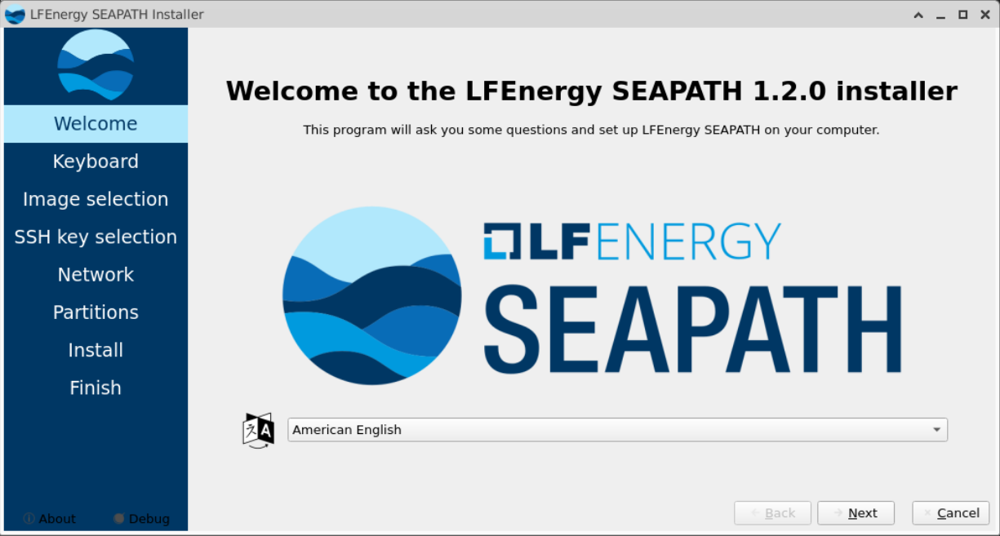

[Getting started](../../Getting%20started.md) > [Quick start](../Quick%20start.md)

# Install SEAPATH

The SEAPATH installation uses the [seapath-installer](https://github.com/seapath/seapath-installer) tool. It can:

- Install SEAPATH (Yocto/Debian or others) on the physical machine disk
- Configure basic access to the SEAPATH machine (SSH keys, IP address, keyboard layout, etc), without needing to regenerate an image

The installation process is done though a live environment, booted from a USB key.

# Get the installer

Get the release of the installer, with SEAPATH images embedded inside.

|                                                                                                         |                                                                                         |
|:--------------------------------------------------------------------------------------------------------|:----------------------------------------------------------------------------------------|
| version 1.2.1 (latest)   SHA256: `31375dc287084d47e83e5774373387d44c446ecedcddecf395553382852c39ee` | <https://drive.google.com/file/d/1hD5b0kkNdOq6ryapUAxXnK1G-sWLW6_5/view?usp=drive_link> |

## Flash the installer

Flash the downloaded file on a USB key

This can be done with

- Graphical tool like [balenaEtcher](https://etcher.balena.io/) (recommended for non IT people)
- A standard `dd` command (recommended for IT people)

The USB key must have 8GB of memory at minimum.

# Use the installer

> [!IMPORTANT]
> By default, the installer is filled with default images and default SSH keys. For a first SEAPATH test, we recommend sticking to that.  
> For more advanced usage, you can read about modifying the SSH key and images at [Advanced SEAPATH image installation](../../Advanced%20configurations/Advanced%20SEAPATH%20image%20installation.md)

## Boot on the installer

Plug the installer USB key on the target machine and configure your BIOS boot entries to boot on it.

Once booted, the installer automatically shows up on the screen.

From now, follow the instruction on the screen to install SEAPATH on your  
target machine.

Once the installation process is done you can reboot the target machine.

> [!NOTE]
> The machine will reboot directly on the installed SEAPATH. Once its done, you can remove the installer USB key

## Report an issue

If you encounter an issue on the use installer, you can raise an issue of the following repositories:

- <https://github.com/seapath/seapath-installer> for the installer tool itself.
- <https://github.com/seapath/seapath-live-installer> for the live OS environment.

# Go on with your machine configuration

> [!NOTE]
> All of your SEAPATH machines must be flashed with the installer.  
> If you are setting up a cluster, repeat [Install SEAPATH](Install%20SEAPATH.md) on each hypervisor.

Once your machine(s) is flashed, you shall continue the configuration by following the next pages of the Quick start

- [Wire and connect to the machines](Wire%20and%20connect%20to%20the%20machines.md)
- [Wire and connect to the machines](Wire%20and%20connect%20to%20the%20machines.md)
- [Deploy your first virtual machine](Deploy%20your%20first%20virtual%20machine.md)
