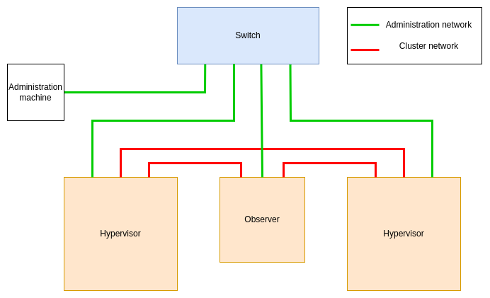
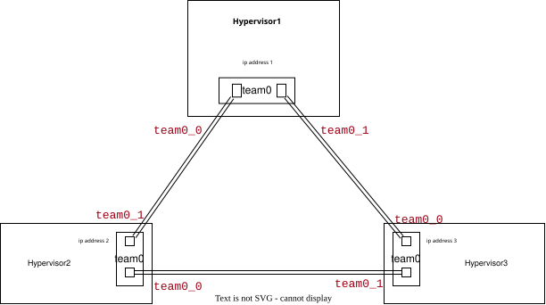

[SEAPATH fundamentals](../../SEAPATH%20fundamentals.md) > [High availability cluster](../High%20availability%20cluster.md)

# Cluster configuration

# **Machine wiring**

Each cluster machine must be wired to the two others with an Ethernet cable. This forms a triangle (loop) network between the cluster machines, which allows them to communicate on a separate network.

> [!NOTE]
> Each cluster machine must be accessible through SSH from the administration machine. For the administration network, we advise using a switch, but this is not mandatory, and other network topology works.

# Ansible inventory configuration

## Ansible groups

The three machines of the cluster must be part of the `cluster_machines` group in the Ansible inventory. This is the case in the default cluster example inventory.

## The cluster network

Inside the Ansible inventory, the cluster network is defined **on each machine** by

- The names of the interfaces connected to the other cluster machines: `team0_0` and `team0_1`
- The cluster IP address of the machine: `cluster_ip_addr`
- The cluster IP address of the other machines: `cluster_next_ip_addr` and `cluster_previous_ip_addr`

To simplify the mental image, we recommend thinking of the 3 hosts following each other in the loop "1 --> 2 --> 3 --> 1"

- if N=1, then N+1=2
- if N=2, then N+1=3
- if N=3, then N+1=1

Then, for the interfaces management, on host N:

- `team0_0` should be connected to `team0_1` of host N+1
- `team0_1` is connected to `team0_0` of host N-1

> [!IMPORTANT]
> Remember that the cluster network is entirely separate from your infrastructure. You can then let the default IP address given in the example inventory.

You can find a description of all variables, plus other customization in the Ansible galaxy documentation :

- The creation of the team0 bridge is done by Open vSwitch in the role [network\_clusternetwork](https://galaxy.ansible.com/ui/repo/published/seapath/ansible/content/role/network_clusternetwork/).
- The allocation of the IPs is done by the systemd\_networkd role. This role reads the files `vars/network_*.yml` to create systemd-networkd files.

> [!NOTE]
> The systemd\_networkd role + network var files system doesn’t allow to properly document the variables in Ansible Galaxy. It should be refactored for future releases.

## Ceph configuration

The Ceph configuration includes several parts

- Configuring Ceph networks: `public_network` and `cluster_network`
- Configuring Ceph daemon location: `mons`, `osds` and `clients`
- Configuring Ceph disk: `ceph_osd_disk` or `lvm_volumes`

The example inventory already provides most of the configuration. The important things to remember are:

- Each machine of the cluster is a Ceph client and a Ceph monitor (i.e., must be part of the `mons` and the `clients` group)
- Each hypervisor of the cluster is a Ceph OSD (i.e., must be part of the `osds` group)
- Ceph networks must use the cluster network defined above
- Ceph can either use one entire disk (`ceph_osd_disk`) or use predefined LVM volumes (`lvm_volumes`).

More information and customization on

- [ceph\_prepare\_installation](https://galaxy.ansible.com/ui/repo/published/seapath/ansible/content/role/ceph_prepare_installation/) Ansible role: Prepare the physical disks or the lvm\_volumes
- [ceph\_expansion\_vg](https://galaxy.ansible.com/ui/repo/published/seapath/ansible/content/role/ceph_expansion_vg/) Ansible role: Extend the logical volume defined for ceph
- [ceph\_expansion\_lv](https://galaxy.ansible.com/ui/repo/published/seapath/ansible/content/role/ceph_expansion_lv/) Ansible role: Extend the logical volume defined for ceph
- [ceph-ansible](https://docs.ceph.com/projects/ceph-ansible/en/stable-6.0/) documentation: External repository to deploy ceph with ansible (note that SEAPATH uses ceph-ansible stable-6.0)

> [!IMPORTANT]
> SEAPATH is also compatible with ceph-adm deployment. This is accessible by putting the variable `force_cephadm` to true.  
> However, it is only available on the Debian version and on the main branch of the SEAPATH Ansible repository. It should be released with the v1.2.
>
> You can find the documentation directly on GitHub on the [cephadm role](https://github.com/seapath/ansible/tree/main/roles/cephadm).

## Corosync/Pacemaker configuration

Corosync is configured using exclusively the cluster network. Pacemaker runs on top of Corosync.

There is no configuration to do for this part, the default behavior should work well. However, possible customization can be found in the [configure\_ha](https://galaxy.ansible.com/ui/repo/published/seapath/ansible/content/role/configure_ha/) Ansible role.

> [!NOTE]
> Especially, it is possible to write additional crm commands to run when pacemaker start with `extra_crm_cmd_to_run`.

## OpenVswitch extended bridge

It is possible to deploy extended bridges over the cluster with Open vSwitch. See this page for reference: [Create an extended bridge over the cluster](Create%20an%20extended%20bridge%20over%20the%20cluster.md)

## Additional cluster configurations

Theses additional Ansible roles also uses the cluster network for minor features. They do not require specific configuration.  
See their documentation for available customization.

- [add\_livemigration\_user](https://galaxy.ansible.com/ui/repo/published/seapath/ansible/content/role/add_livemigration_user): Configure the user used for live migration on the cluster
- [configure\_admin\_user](https://galaxy.ansible.com/ui/repo/published/seapath/ansible/content/role/configure_admin_user/): Configure SSH connection between machines on the cluster network
- [configure\_libvirt](https://galaxy.ansible.com/ui/repo/published/seapath/ansible/content/role/configure_libvirt/): Create an RBD pool for libvirt

# Ansible playbooks

The cluster is deployed as part of the SEAPATH configuration in `seapath_setup_main.yaml` playbook.

Below is a more precise list of playbooks involved in the cluster deployment. You can launch these playbooks separately to reconfigure something.  
All these playbooks are called by the `seapath_setup_main.yaml` playbook.

- `seapath_setup_network.yaml`: Configure the network on each machine, including the administration network, cluster network, and additional OVS bridges
- `cluster_setup_libvirt.yaml`: Create an RBD pool for libvirt
- `cluster_setup_users.yaml`: Set up the live migration user and enable the SSH access from one machine to another over the cluster network.
- `cluster_setup_ceph.yaml`: Configure Ceph using ceph-ansible
- `cluster_setup_ha.yaml`: Configure corosync/pacemaker

# Troubleshooting

## Ceph fails to form the quorum

The problem is probably coming from the cluster network itself. In your Ansible inventory :

- Verify your team0 interface names
- Verify all cluster IP addresses for all machines
- Verify the Ceph networks

Then redeploy SEAPATH using the `seapath-setup-main.yaml` playbook.
