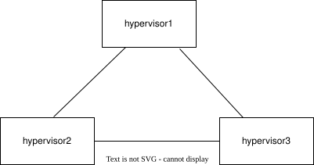
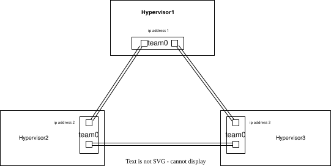
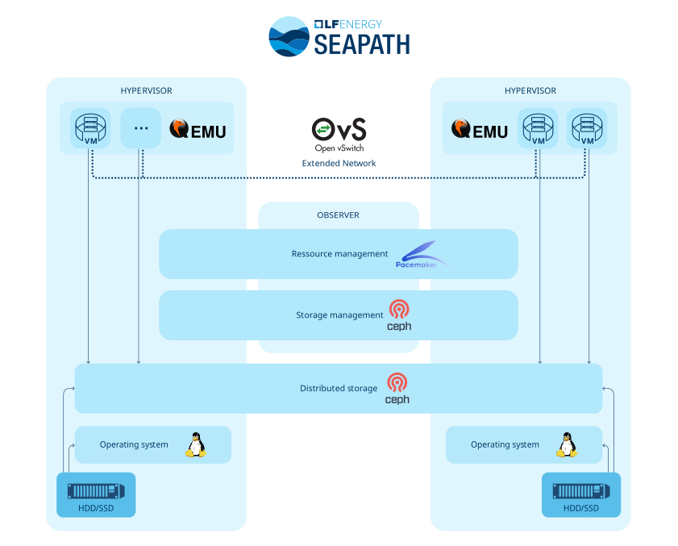

[SEAPATH fundamentals](../../SEAPATH%20fundamentals.md) > [High availability cluster](../High%20availability%20cluster.md)

# High availability cluster on SEAPATH

SEAPATH allows redundancy of hypervisors based on third parties open-source technologies. Specifically

- Detect a hypervisor failure (ex: power shutdown, Network loss) within the cluster
- Move services to another hypervisor of the cluster
- Replicate data within the cluster

The main features of the cluster are :

- Resource management: communication between the different machines within a group is managed by Pacemaker and two of its plugins. Corosync is used for the intercluster communication and the Heartbeat mechanism while STONITH implements the fencing system.
- Distributed storage: All data written to disks is replicated and synchronized within the group members by using the CEPH tool. Note that from a user point of view only a single instance of each VM can be started on the system at the same time.
- Intelligent network: The different machines on the cluster are connected on the layer level (OSI model) using OpenVSwitch (optionally DPDK) for its administration and management.

The cluster allows to protect against these faults:

- Loss of a hypervisor
- Loss of a physical link (Ethernet cable) between two cluster machines
- More information on the cluster fail-over scenario page (TODO)

# Cluster architecture

A SEAPATH cluster is composed of three physical machines. Two different setup are available in SEAPATH.

- Three hypervisors setup
- Two hypervisor + one observer setup

> [!IMPORTANT]
> Why these two setups ?   
> To achieve virtual machine redundancy, at least two hypervisors should be used. The third machine is necessary for fault recovery, but is not necessarily a hypervisor.

The three machines of the cluster are wired together in a loop architecture

> [!NOTE]
> It would also be possible to use external switches for this cluster network. This would require 2 switches interconnected together for high availability.  
> This is not the architecture used in SEAPATH.

## Observer or Hypervisor as third machine

A third machine is necessary on the cluster to enable fault recovery. This third machine can be either another hypervisor or an observer machine.

An observer machine aims to be less powerful and cheaper than a hypervisor. The key differences are

- It will not run any virtual machine
- It will not host distributed storage (CEPH)
- It will not run extended network (OVS)

The choice of a third machine should be based on the number of VM that will run on your setup.

- A three-hypervisor setup allows you to run more virtual machine
- A two-hypervisors, one-observer setup will be cheaper

> [!IMPORTANT]
> In the rest of this section, unless specified otherwise, you can treat the third machine as an observer or an hypervisor indifferently

## Cluster network

SEAPATH uses a layer 2 networking solution (using OpenVSwitch), where each host runs a software bridge ("team0"), with 2 ports connected to external network interfaces. Each of the 2 network interfaces is connected to one of the other hosts. The IP address for the host on this cluster network is directly set to the team0 bridge:

This network is used by multiple elements:

- Ceph handles the shared storage and the replication of data over the different physical machines. It is then used to store the virtual machines disks in order to achieve redundancy of the VM data.
- Corosync and Pacemaker handle the software resources to run over the cluster’s physical machines. On SEAPATH, resources are mostly virtual machines but can also be other software.
- Open vSwitch provides extended bridges over the cluster. These bridges can be used to communicate between the different resources, no matter which physical machine is currently running them.

