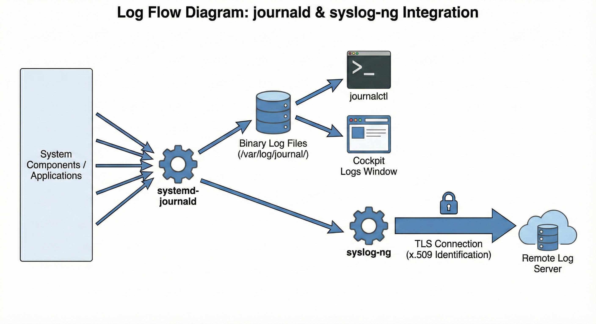

[SEAPATH fundamentals](../../SEAPATH%20fundamentals.md) > [Supervision](../Supervision.md)

# Logs management

This page details the log management infrastructure within the SEAPATH platform, covering local storage, inspection tools, and remote logging capabilities.

## Local Log Storage and Management

SEAPATH relies on **systemd-journald** for collecting and storing log data.

- **Tooling:** Interaction with the logs is primarily handled via the `journalctl` utility. For detailed documentation on command usage, refer to the [official journalctl manual](https://www.freedesktop.org/software/systemd/man/latest/journalctl.html).
- **Storage Location:** Logs are stored in a binary format located in a dedicated logs partition. These are accessible within the system at `/var/log`.

## Log Inspection

### Graphical User Interface (Cockpit)

For users preferring a visual interface, SEAPATH integrates log inspection into the Cockpit web GUI.

- **General Logs:** You can view system-wide logs on the dedicated **Logs page**.

  - *Reference:* [Using a graphical interface on Seapath](Using%20a%20graphical%20interface%20on%20Seapath.md)
- **Service Logs:** Logs specific to individual system services can be viewed via the **Services page**.

  - *Reference:* [Using a graphical interface on Seapath](Using%20a%20graphical%20interface%20on%20Seapath.md)

### Filtering Capabilities

Whether using the CLI or the GUI, logs can be filtered using several criteria to assist in troubleshooting:

#### By Severity

Logs can be filtered by specific priority levels (from highest urgency to lowest):

1. **Emergency**
2. **Alert**
3. **Critical**
4. **Error**
5. **Warning**
6. **Notice**
7. **Info**
8. **Debug**

#### By Time and Context

- **Date:** Filter logs within specific time frames.
- **Boot Session:** Isolate logs related to the current boot or previous specific boot sessions.

#### By Source

- **Identifier:** Filter by syslog identifier.
- **Service:** Filter logs generated by specific systemd units or services.

## Remote Logging

SEAPATH supports forwarding logs to a remote server using **syslog-ng**. This ensures logs are preserved externally for auditing and security analysis.

The remote server needs to support the syslog protocol the TLS encryption with x.509 identification.

### Security

Remote logging is secured using **TLS encryption** involving mutual authentication via x.509 certificates:

- Client Certificate (SEAPATH machine)
- Server Certificate (Remote Log Server)

### Configuration

The configuration of the remote logging parameters is handled via **Ansible**. Administrators can define the following:

- Remote Server IP Address
- CA Certificate
- Client Public Key
- Client Private Key

Refer to the [SEAPATH Ansible roles documentation](https://galaxy.ansible.com/ui/repo/published/seapath/ansible/docs/).

> [!CAUTION]
> **Important:** The remote logging feature using syslog-ng described above does not work with the 1.0 to 1.2 versions of SEAPATH.
>
> Refer to issue <https://github.com/seapath/ansible/issues/835>
