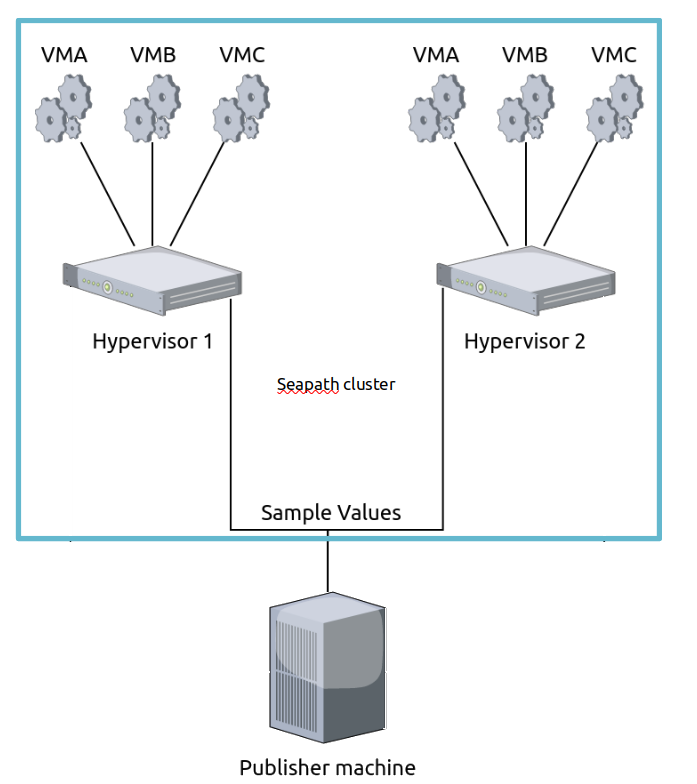
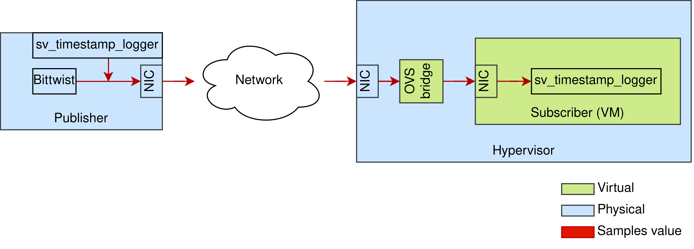

[Tests and CI](../Tests%20and%20CI.md)

# IEC61850 latency tests

# **Setting the context**

The following part describes the integration of a IEC61850 traffic simulation with a SEAPATH infrastructure (cluster or standalone). The main idea is to generate IEC61850 Samples Value (SV) from a standalone machine (aka “publisher”), outside the SEAPATH cluster. The SV will transit to the SEAPATH cluster, and will be proceeded inside one or many virtual machines by a receiver (aka “subscriber”).



The IEC61850 norm defined, in a 50Hz electric network, that each SV should be paced at a rate of 4KHz, and thus, to wait 250µs between each sent of SV (4.8KHz and 208µs in a 60Hz network). In this document, we will use the 50Hz frequency as a reference.

So, to be accurate, the simulation IEC61850 traffic should be paced the most close to 4KHz between the emission of the SV on the publisher to it reception on the subscriber. Note that:

- If your pacing is too quick (<< 250µs), the subscriber will not have enough time to proceed the SV, and will result of SV dropping.
- If your pacing is too low (>> 250µs), the subscriber will be waiting between each SV sent, introducing latency in the simulation.

# **CI latency tests**

In both Seapath Yocto and SEAPATH Debian CI, IEC61850 latency tests are performed weekly and at each pull request. These tests ensure that any modification made on SEAPATH is not increasing negatively the performance. The following part describes the requirements and the steps to setup a generic latency test CI infrastructure.

> [!IMPORTANT]
> The Seapath infrastructure used for a latency test CI is a standalone configuration of Seapath.

## **Generic CI overview**



The structure of a generic CI for latency tests is composed as follows:

- Publisher machine send IEC61850 SV from an existing PCAP. This PCAP defines various parameters such as the number of streams, the size of an SV etc. For more information about PCAP generation, see part X. PCAP generation
- A special software called sv\_timestamp\_logger is loaded in a container and logs, for every SV sent, their timestamp
- Publisher and subscriber machines are connected together through a dedicated Network interface. We recommend isolating the SV on a dedicated NIC to prevent any perturbation from another network stream.
- Subscriber machine receives the IEC61850 SV. The IEC61850 SV can be directly:

  - Eeceived and decoded on a physical machine.
  - Received and decoded on a virtual machine. In this case, SV are first received on a physical host machine (hypervisor) and then transmitted to the VM.   
    The method for transmitting SV’s to the VM can be using PCI-Passthrough or virtually, using an OpenVSwitch bridge and virtual port.

> [!IMPORTANT]
> The reception, the decode, and the record of the timestamp of each SV is also done by an instance of the software sv\_timestamp\_logger

> [!IMPORTANT]
> In this document, we will use a virtual machine as a subscriber and using OpenVSwitch to transmit SV to the VM.

## **Requirements**

### **Publisher**

#### **Hardware**

Any machine that could run a recent Linux RT distribution can be used as a publisher machine. But for better performance, we recommend at least a 4 cores CPU, in order to have enough cores to isolate RT process. X86 or ARM CPUs can be used, but we recommend at least Intel i5 or ARM Cortex-A53 based CPUs for better performance. Note that on recent platforms, CPUs comes with implementation of “performance” and “efficient” cores, running at different speed, and so could reduce system determinism.

A 1 Gigabit network interface should be used for the SV sent, isolated from any network to avoid interference.

#### Software

A Real-Time kernel is highly recommended to increase the publisher determinism. Tests with a Debian 12 distribution with an RT kernel showed good performance.

For traffic generation, we recommend using the package **Bittwist**: <https://bittwist.sourceforge.io/>

You can also use the package **Tcpreplay** (<https://github.com/appneta/tcpreplay>), but note that tests showed that Bittwist gives more performance over Tcpreplay in an RT context.

### **Subscriber**

#### **Hardware**

As well as publisher machine, any machines that could run a recent Linux RT distribution can be used as a publisher machine. Physical and virtual machines can be used.

#### **Software**

#### sv\_timestamp\_logger

For the reception and decoding SV frames, we use the Seapath source tool sv\_timestamp\_logger: <https://github.com/seapath/sv_timestamp_logger>

In order to use it, you first need to get the SV parser from : <https://github.com/seapath/sv_parser> and put it in the lib directory of sv\_timestamp\_logger sources.

Then to build it, run:

```bash
docker build . --tag sv_timestamp_logger
```

And save it as an archive (if you need to export it to a target for example):

```bash
docker image save -o sv_timestamp_logger.tar sv_timestamp_logger
```

You can then load it on the target using:

```bash
docker image load -i sv_timestamp_logger.tar
```

## **PTP configuration**

As tests are driven on different machines, their clock needs to be synchronized together in order to get the most accurate latency tests.

To do so, you can set up a PTP network by using the steps provided in page [(TO ARCHIVE) Time synchronization (OLD)](../(TO%20ARCHIVE)%20Time%20synchronization%20(OLD).md).

## **PCAP data generation**

The PCAP format (Packet CAPture) is a file format used to replicate a network behavior. You can build a pcap containings sampled values on [sv-pcap-generator](https://github.com/seapath/sv-pcap-generator) repository.

## **Running your first latency test**

### **On subscriber side**

To run the sv\_timestamp\_logger, you can use for example this simple command:

```bash
 docker run --privileged \
-d \
-v /tmp:/tmp \
--name sv_timestamp_logger \
--network=host \
sv_timestamp_logger \
-d enp3s0 \
--first_SV_cnt 0 \
--max_SV_cnt 4000
```

This command will execute the sv\_timestamp\_logger in a Docker container with the following argument:

- `-d` argument is the interface where the SV are received
- `first_SV_cnt` is the first counter value of the first SV
- `max_SV_cnt` is the maximum SV counter value

In addition to these arguments, you can also set the following arguments:

- `-t` to use the hardware timestamping functionality, if the NIC where the data are received is compatible with.
- `-s` to log only a specific SV stream. This argument can be useful to reduce the CPU load and the size of the result files.
- `-f` to store the SV timestamp in a result file.

The following Docker arguments are also needed:

- `--privileged` if not set, you will get the error `sched_setscheduler: Operation not permitted.`
- `--network host` to make the container access the host interfaces.

> [!IMPORTANT]
> Docker `-d` argument can be used to run the container in background.

> [!IMPORTANT]
> To increase determinism, it is strongly recommended to isolate the sv\_timestamp\_logger on a specific core using `--cpuset-cpus` argument.

The subscriber is now ready and listen to incoming SVs.

### **On publisher side**

First, an instance of the sv\_timestamp\_logger must also be run, in order to record the timestamp of the SV when they have been emitted.

Using the PCAP file previously generated, SV can be generated across network using:

- bittwist:

```bash
bittwist -i <INTERFACE> <PCAP>
```

Or

- tcpreplay:

```bash
tcpreplay -i <INTERFACE> <PCAP>
```

For increasing determinism, it is highly recommended to isolate on a specific core:

- The IRQ interface process used to send SV. If your network interface provides many TX queues, we recommend pinning, if possible, one core per IRQ process.
- The bittwist/tcpreplay process, with the lowest process priority.

To do this, you can use the following command:

```bash
taskset -c <CORE> chrt --fifo 1 <COMMAND tcpreplay/bittwist>
```

If you need a longer test, you can use the loop `-l` argument (bittwist and tcpreplay). With this argument, the PCAP file will be replayed once the end has been reached.

## **Data analysis**

Once the tests have ended, sv\_timestamp\_logger can be stopped using:

```bash
docker stop sv_timestamp_logger && docker kill sv_timestamp_logger
```

The data generated by the sv\_timestamp\_logger looks the following:

```java
0:svID0000:0:1727698715978775
0:svID0001:0:1727698715978797
0:svID0002:0:1727698715978804
0:svID0003:0:1727698715978810
0:svID0004:0:1727698715978816
0:svID0005:0:1727698715978822
0:svID0006:0:1727698715978828
0:svID0007:0:1727698715978834
0:svID0000:1:1727698715979021
```

- The first column designates the number of the loop of the PCAP file being played. In this example, only the first PCAP loop is played.
- The second column designates the stream ID of each SV recorded. In this example, the stream ID is starting from 0 to 7.
- The third column designates the SV counter of each SV recorded.
- The last column designates the timestamp when the SV has been recorded, in µs. This timestamp follows the UNIX time format “Epoch” (number of µs elapsed since 01/01/1970).

A latency test can be conducted between two instances of sv\_timestamp\_logger launched on two different machines. The results can be computed with the [sv-timestamp-analysis](https://github.com/seapath/sv-timestamp-analysis) repository.
