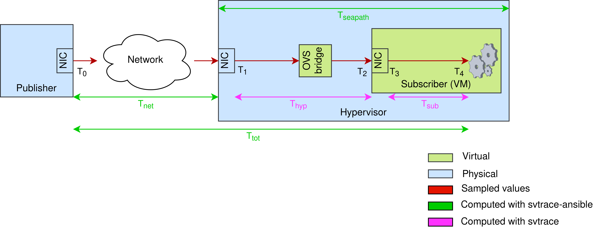
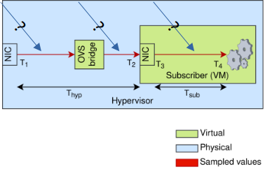

[Tests and CI](../../Tests%20and%20CI.md) > [SEAPATH toolbox](../SEAPATH%20toolbox.md)

# IEC61850 SV monitoring

## Svtrace tools

Svtrace are a set of tools used to monitor the IEC61850 SV transit performance on a SEAPATH architecture. Svtrace project is composed of two distinct tools:

- [svtrace-ansible](https://github.com/seapath/svtrace-ansible), for latencies computation across hosts of a SEAPATH architecture
- [svtrace](https://github.com/seapath/svtrace), for latencies computation on a machine itself.

Both tools are under APACHE 2 license.



Svtrace tools operates in a SEAPATH architecture composed of:

- **A publisher machine**: It send the IEC61850 SV and optionally, can be used as a hardware PTP source.
- **A SEAPATH hypervisor**: it receive the IEC61850 SV and transit them to each virtual subscriber through an OVS bridge.
- **One or many SEAPATH subscriber (virtual machine)**: It receive the IEC61850 SV and proceed them.

> [!IMPORTANT]
> Currently, svtrace tools are only compatible in a SEAPATH standalone configuration.

### **Svtrace-ansible**

[svtrace-ansible](https://github.com/seapath/svtrace-ansible) focuses on assessing the efficiency and reliability of a SEAPATH architecture by performing network latency tests. Using IEC61850 protocol, Samples Value are emitted from a publisher machine in destination of a subscriber machine, which will receive, parse, and decode them. The subscriber machine can be a physical machine or a virtual machine hosted on a hypervisor.

The main purposes of svtrace-ansible are:

- Compute the latencies between each host implied in the IEC61850 SV transit, with high precision (+/- 10µs)
- Identify bottlenecks in a SEAPATH architecture

Various latency metrics are computed at various stage of the transit of the Samples Value between each machine, and inside them:

- Network latency (T<sub>net</sub>): Time elapsed between the emission of an SV (T<sub>0</sub>) from the publisher machine to the NIC of the hypervisor machine (T<sub>1</sub>).
- SEAPATH latency (T<sub>seapath</sub>): Time elapsed between the reception of an SV on the hypervisor (T<sub>1</sub>) to it proceed in the virtual machine (T<sub>4</sub>).
- Total latency (T<sub>tot</sub>): Time elapsed between the emission of an SV (T<sub>0</sub>) from the publisher machine to it proceed in the virtual machine (T<sub>4</sub>). This latency is equal to the network latency plus the SEAPATH latency.

### Requirements

#### Localhost machine

The localhost machine is responsible of the execution and the orchestration of the execution of the latency tests.

First make sure Docker is installed on the machine. See <https://docs.docker.com/engine/> to install it following the distribution you are using.

Svtrace-ansible uses [cqfd](https://github.com/savoirfairelinux/cqfd), a quick Docker command executioner. To install it use:

```java
git clone https://github.com/savoirfairelinux/cqfd.git
cd cqfd
sudo make install
```

If you wish to run svtrace-ansible directly on your machine, without docker (not recommended), make sure it complies with the following dependencies:

```java
sudo apt install \
ansible \
bash \
python3 \
python3-pip \
rsync
 
sudo pip install \
matplotlib \
numpy
```

SV proceed is done using [sv\_timestamp\_logger](https://github.com/seapath/sv_timestamp_logger) utility. A container archive must be created and placed in `svtrace-ansible/files/docker/sv_timestamp_logger` directory. To do so, run:

```java
git clone https://github.com/seapath/sv_timestamp_logger.git
git clone https://github.com/seapath/sv_parser.git
cp ./sv_parser/* ./sv_timestamp_logger/lib/
docker build sv_timestamp_logger/ --tag sv_timestamp_logger
docker image save -o sv_timestamp_logger.tar sv_timestamp_logger
cp sv_timestamp_logger.tar svtrace-ansible/files/docker/sv_timestamp_logger
```

#### Publisher machine

The publisher machine is responsible of sending the IEC61850 SV.

> [!IMPORTANT]
> Currently, svtrace-ansible do not support other sending method (such as a dedicated hardware).

First make sure Docker is installed on the machine. See <https://docs.docker.com/engine/> to install it following the distribution you are using.

IEC61850 SV are sent using bittwist utility. We recommend to get the last version on bittwist repository: <https://bittwist.sourceforge.io/> .

Then, install `rsync` package.

Finally, make sure you have a dedicated user with sudo access that can be use by Ansible.

#### Hypervisor and subscriber machines

The hypervisor machine is responsible of hosting and transmit the SV to the subscriber (in a virtual machine), and the subscriber machine is responsible of the processing of SV.

As well as other machines, make sure Docker is installed. Then ensure following dependencies are satisfied:

```java
docker
psmisc
rsync
tshark
```

A dedicated user with sudo access must be available.

#### IEC61850 SV PCAP samples

Valid IEC61850 SV PCAP are needed to run svtrace-ansible. We recommend to generate them using SEAPATH project [sv-pcap-generator](https://github.com/seapath/sv-pcap-generator). The generated pcap are then expected to be located on the publisher machine, with the path specified using inventory `pcap_file` variable.

### Configuration

#### Time synchronization

##### **Systems**

For achieving high accuracy latency measure each machine must be synchronized using the PTP protocol. To implement PTP on SEAPATH you can follow the detailed procedure in the SEAPATH Wiki, section "Time synchronization": <https://wiki.lfenergy.org/display/SEAP/Time+synchronization>.

> [!IMPORTANT]
> NTP protocol is not enough accurate to ensure reliable latency tests.

For better PTP performance, we recommend:

- The isolation, if possible of `ptp4l` and `phc2sys` process
- To use publisher with hardware PTP support
- To use PTP L2 network transport and P2P delay mechanism
- To use linreg clock servo for `ptp4l` and `phc2sys` configuration
- In the case of a virtual machine as a subscriber, using `kvm_ptp` module is highly recommended.

**Network cards**

If NIC hardware timestamping is used, the NIC clock must be also synchronized in PTP with the same source as other machines.

#### Inventory

Inventories must be provided when running svtrace-ansible. See inventories/README to get more information.

Finally, run following command to apply the configuration on each machine:

```java
cqfd -b configure_tests
```

### Usage

After configuration, the tests can be launched with the playbook `run_latency_tests.yaml`:

```java
cqfd -b run_tests
```

Test duration can be set achieved using `pcap_cycles` inventory variable. It represent the number of times the pcap file is replayed.

The threshold of latency variables can be set in the var file `threshold.yaml`. To record all SV data, set the threshold value to 0.

At the end of the test, test results are available in a generated directory `tests_results/`.

### Svtrace

[svtrace](https://github.com/seapath/svtrace) is a complementary tool used to investigate IEC61850 SV latencies on a host itself. When svtrace-ansible is designed to target latencies bottleneck between host of the SEAPATH architecture, svtrace is designed to target the ones inside the kernel itself, and so to get a more fine map of the IEC61850 SV transit.



Svtrace is based on [bpftrace](https://github.com/bpftrace/bpftrace) to monitor the transit of SV inside the kernel host. It is designed to work either on a phys

ical machine or a virtual machine.

Currently, svtrace works only with QEMU virtualization agent using vhost-net drivers virtualization on the host side and virtio drivers on the VM side.

Note: svtrace do not need PTP synchronization to run as latencies computation is done on the same host.

Two main features are provided:

- live: direct in terminal latencies measurements, represented as an histogram
- record: measured latencies are recorded in a file, which can be used later for post-processing

A presentation of the svtrace tool, made at the FOSDEM 2025 is available here: <https://fosdem.org/2025/schedule/event/fosdem-2025-5521-lfenergy-seapath-svtrace-tools-for-latency-analysis-in-virtualized-networking-platforms/>

#### Installation

First, make sure the following dependencies are satisfied:

```java
python3
python3-setuptools
tshark
```

Then, install bpftrace; We recommend a version higher than 0.20.0, as svtrace is based on recent release features.

```java
wget https://github.com/bpftrace/bpftrace/releases/download/v0.21.2/bpftrace .
chmod +x bpftrace
```

To install svtrace run:

```java
git clone https://github.com/seapath/svtrace.git
cd svtrace
python3 setup.py install
```

#### Configuration

A configuration file `svtrace.cfg`must be provided to svtrace to run, for example:

```java
[DEFAULT]
SV_INTERFACE=enp7s0
SV_BUFFER_SIZE=100000
```

`SV_INTERFACE` must point to the interface where the IEC61850 SV are received.

`SV_BUFFER_SIZE` represent the maximum SV the internal svtrace buffer can store during test. By default, 100 000 is enough for 8 SV streams, but you might needed to increase it in case of higher streams.

> [!IMPORTANT]
> Keep in mind that increasing SV\_BUFFER\_SIZE also quickly increase the memory footprint of bpftrace.

#### Usage

To start a measurement and print it directly in terminal, on a hypervisor use the following command:

```java
python3 svtrace.py --live --conf svtrace.cfg --machine hypervisor
```

To exit svtrace, hit CTRL+C.

In the same way, to start a measurement and record it in a file, use the following command:

```java
python3 svtrace.py --record --conf svtrace.cfg --machine hypervisor
```

> [!IMPORTANT]
> By default recorded latencies are stored in `/tmp` directory.
