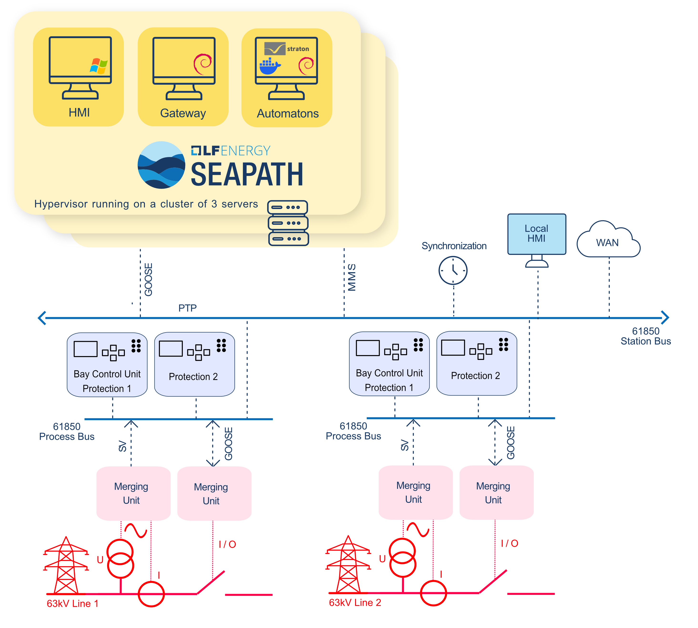
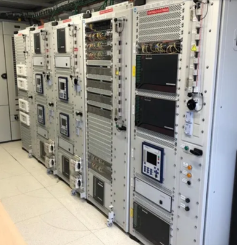
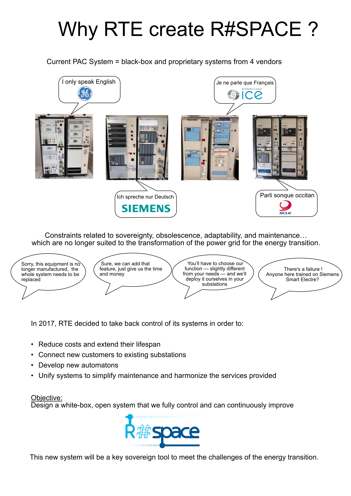
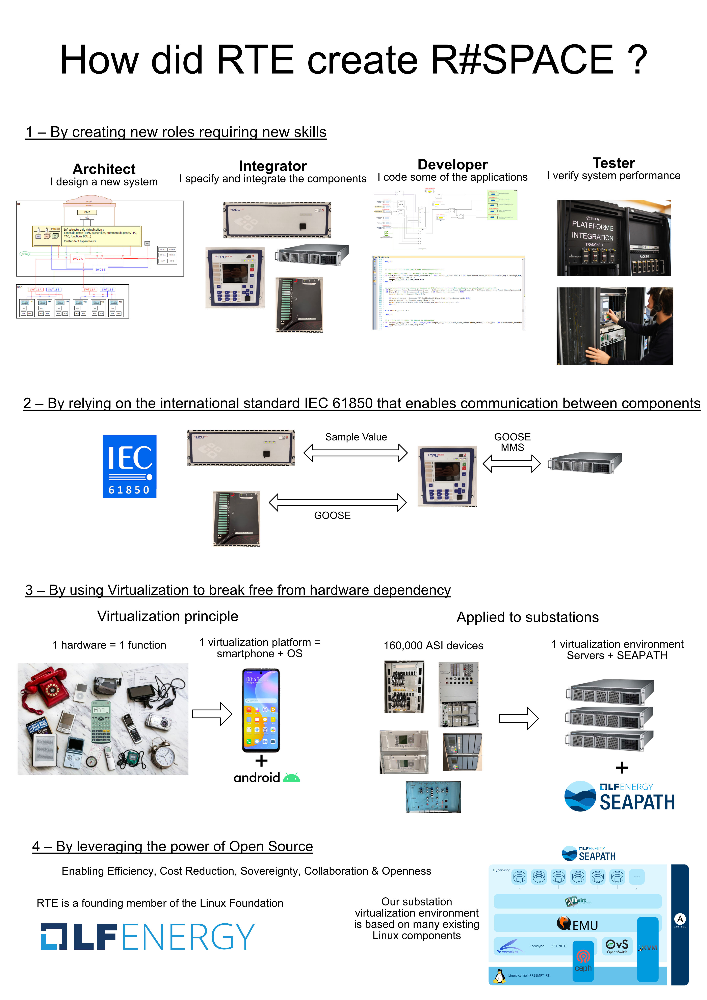
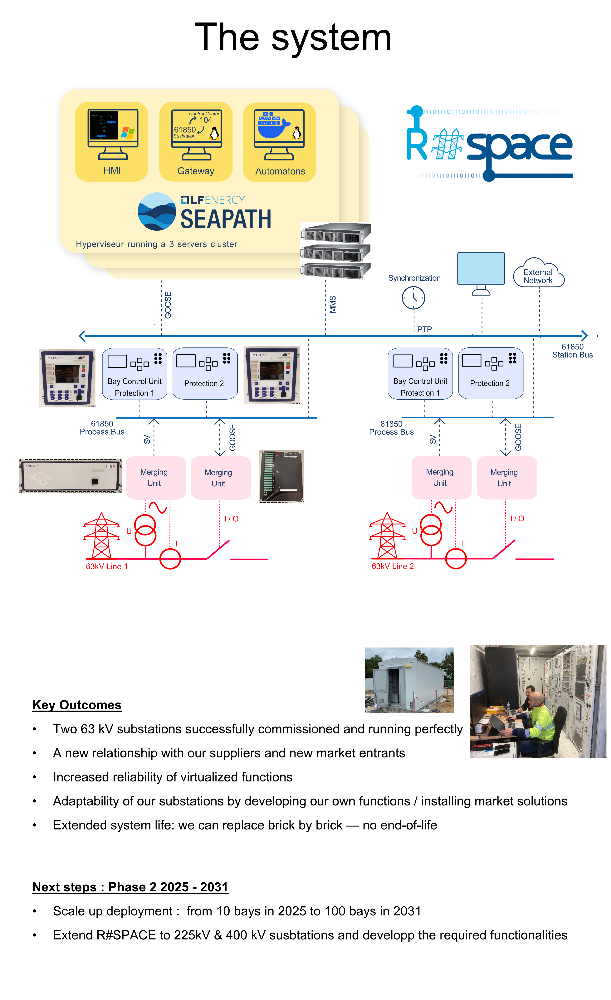

[Who is using SEAPATH ?](../Who%20is%20using%20SEAPATH%20_.md)

# RTE : R#SPACE Industrial Use Case of SEAPATH

## **Overview**

RTE, the French transmission system operator, has successfully implemented SEAPATH as the virtualization environment for its new generation of Protection, Automation, and Control (PAC) systems, known as R#SPACE. This fully digital, IEC 61850-based multi-vendor PACS leverages SEAPATH to enable high-availability and real-time virtualization in substations. Since the end of 2023, the first substation using SEAPATH has been operating seamlessly, with a roadmap targeting 100 bays deployments by 2030.

## **Challenges**

To modernize its substation infrastructure, RTE needed a scalable, interoperable, and cost-efficient virtualization platform for PAC systems. The key challenges included:

- Ensuring real-time processing and high availability in a virtualized environment.
- Achieving vendor independence and an open, cooperative ecosystem.
- Reducing hardware dependencies while maintaining strict operational requirements.

## **What is R#SPACE ?**

It’s RTE’s new generation PAC System : **fully digital, IEC 61850-based and multi-vendor PACS.**

For a description of the R#SPACE System, see § 1 of “[Testing approach for RTE’s R#SPACE - CIGRE Science & Engineering Journal Decembre 2024](https://cse.cigre.org/cse-n035/b5-testing-approach-for-rtes-rspace-protection-automation-and-control-system.html)”

As a long-term goal, R#SPACE aims to virtualize all PAC functions. The first step has been the virtualization of the general substation function using SEAPATH.

The first set of substation functions virtualized are :

- **HMI SCADA**, developed by RTE on the basis of an off-the-shelf SCADA supervisor, provides the interface of the PACS for operation and maintenance. It also plays an important role in advanced diagnostics and cyber-security.
- **Telecontrol Gateway,**  developed by a supplier to interface the R#SPACE site with remote control centers using.
- **Substation-level automations** : Functions such as alarming, voltage regulation, and overload management, developed by RTE using Straton (a Soft-PLC platform) and running in Docker containers. One automaton is part of the circuit breaker failure protection and has a cycle times of 10ms.

## **First deployment**

The initial deployment of SEAPATH in a 63kV substation has demonstrated successful operation since late 2023 with the previous functions virtualized.

Hardware deployed : ADVANTECH ECU 579 with 22 CPU, 128 Go RAM & SSD 960 Go.

One additional substation was deployed in 2024 and three more are planned in 2025. The long-term goal is to have 100 substations by 2030 fully leveraging SEAPATH for PAC virtualization.

## **Next Steps**

RTE is committed to the continued adoption and enhancement of SEAPATH. RTE is convinced that SEAPATH is the solution of the future, enabling TSOs/DSOs to fully realize the promises of virtualization: flexibility, cost efficiency, and mastery of their PAC System.

Future plans focused industrial deployment acceleration across additional substations : up to 400 kV with more complex busbar topologies, and all corresponding PAC functionalities.

RTE will also continue ongoing R&D initiatives to expand the scope of virtualization to protection functions : [RTE : VIP'R R&D Project - VIrtual PAC Rte](RTE%20_%20VIP'R%20R&D%20Project%20-%20VIrtual%20PAC%20Rte.md) .

## **To go further**

Vidéo LFE Summit 2024 : [SEAPATH - Current Application and Perspectives - Bastien Desbos & Florent Carli, RTE](https://www.youtube.com/watch?v=vqoi0GUgynA&list=PLKyFf1J9Xkps70S2J_62V3B1qPhli3Al3&index=5)

[LFE Summit 2024 - SEAPATH - Current application and perspectives.pdf](../../attachments/162d0d3c-df69-49e4-a486-7f2aa13b25f3.pdf)

Smart Grid Technical Forum 2025 : [SGT 2025 - Deploying Virtual Automatons - RTE Straton and SFL.pdf](../../attachments/0f62fbc0-541e-4288-b0ae-ad477b755f32.pdf)

Article PAC World 2023 : [Towards an Industrial Deployment of Fully Digital PACS at RTE](https://www.pacw.org/towards-an-industrial-deployment-of-fully-digital-pacs-at-rte)

