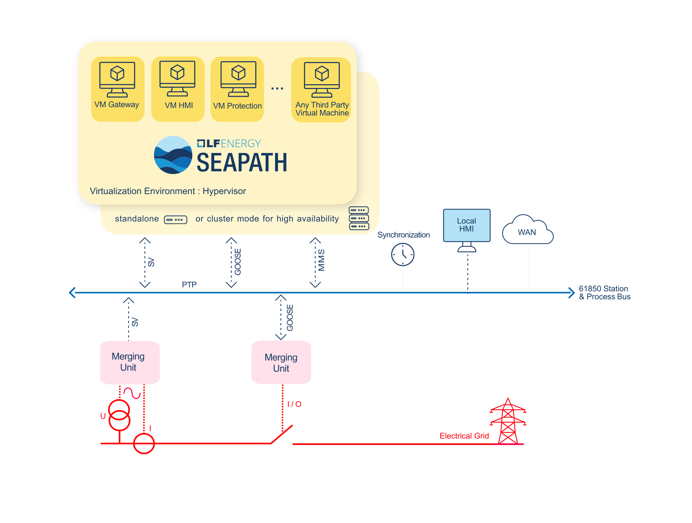
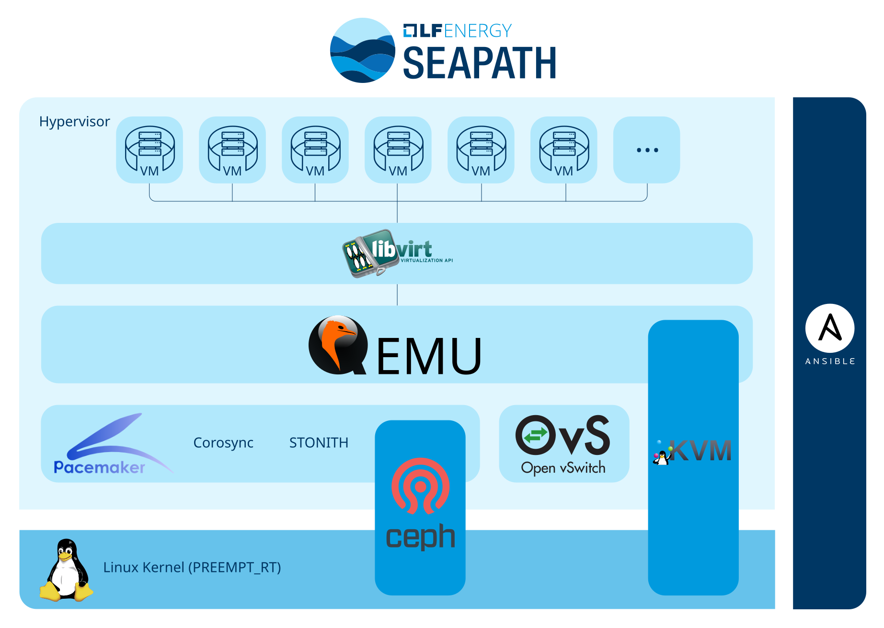

# LF Energy SEAPATH

|  |  |
| --- | --- |
| Status | GRADUATED  ([Project Lifecycle](https://tac.lfenergy.org/process/lifecycle.html#graduated)) |
| Description | Open-source hypervisor for IEC 61850 Digital substations |

Due to the Energy Transition, the use of power transmission and distribution grids is changing. The control architecture of power grids needs to be swiftly adapted to take account of infeed at lower grid levels, higher dynamics in flow patterns, and more distributed controls (both internal controls and grid flexibility services from third parties). In this context, TSOs and DSOs require a new generation of Digital Substation Automation Systems (DSAS) that could provide more complex, dynamic, and adaptative automation functions at grid nodes and edge, as well as enhanced orchestration from central systems, in both flexible and scalable manner. Virtualization is seen as a key innovation in order to fulfill these needs.

SEAPATH, Software Enabled Automation Platform and Artifacts (THerein), aims at developing a “reference design” and “industrial grade” open source real-time platform that can run virtualized automation and protection applications (for the power grid industry in the first place and potentially beyond). This platform is intended to host multi-provider applications.

Due to the nature of the virtualized applications, whose function is to regulate, control, command and transmit information relating to the operation, management and maintenance of an electrical substation, the virtualization base must meet the challenges of reliability, performance and availability.

SEAPATH is a collaborative project, bringing together a diverse community of experts spanning embedded Linux, IT, electrical engineering backgrounds, fostering IT/OT convergence.

SEAPATH is an acronym for Software Enabled Automation Platform and Artifacts (Therein). It is part of the LF Energy Digital Substations Special Interest Group.

## Why choose SEAPATH ?

SEAPATH include the following features:

- **Ecosystem agnostic**, easily used and extended by third parties
    - Hardware agnostic: can be installed on different types of servers and architectures (x86, ARM, etc.)
    - Vendor agnostic: a heterogeneous variety of virtual machines can be deployed and managed on the platform.
    - Open source: released under a permissive open source license (Apache-2.0), enabling effortless adoption, customization, integration into existing projects, and commercialization opportunities for users.
    - On-going integration with other LF Energy Projects from Digital Substations Automation Systems (DSAS) such as LF Energy CoMPAS, LF Energy FledgePOWER, and OpenSCD.
- **High performance**, ready for IEC 61850 applications
    - Real-time capabilities: can host applications with determinism and performance needs.
    - Time synchronization: natively support NTP and PTP (IEEE 1588) synchronizations.
- **Resilience**, robust for mission-critical systems
    - High availability and clustering: offers cluster functionalities to guarantee availability in case of hardware or software failures.
    - Distributed storage: data and disk images of the virtual machines are replicated and synchronized to guarantee its integrity and availability on the cluster.
    - Automatic updates: The system can be automatically updated from a remote server.
- **Infrastructure as code, **allowing automated and remote system management
    - Configuration: initial configuration is done using scripted tasks, ensuring exact replication of desired operations and avoiding manual errors.
    - Administration: can be easily managed from a remote machine connected to the network as well as by an administrator on site.
- **Intensive testing**, guaranteeing capabilities and avoiding regression
    - Continuous integration: Every development on the platform must pass more than 700 unit tests, real time tests and latency tests.
    - Testing-driven cybersecurity approach: each requirement is ensured through extensive unit tests.

## SEAPATH in Digital Substations

SEAPATH is designed to host various types of virtual IEDs (Intelligent Electronic Devices). It meets the necessary criteria to enable these IEDs to communicate using the IEC 61850 protocols.

## SEAPATH architecture

The virtualisation platform uses the following open source tools:

- [QEMU](https://www.qemu.org): Emulator and virtualizer that can perform hardware virtualization.
- [KVM](https://www.linux-kvm.org): Linux module that offers virtualization extensions so  the machine is capable of functioning as a hypervisor.
- [Libvirt](https://libvirt.org/): virtualization API and management tool used to configure virtual machines simulated hardware.
- [Pacemaker](https://clusterlabs.org/pacemaker/): High availability resource manager that offers clustering functionalities. It is used in combination with its plugins Corosync + STONITH.
- [Ceph](https://docs.ceph.com): Scalable distributed-storage tool that offers persistent storage within a cluster.
- [Open vSwitch](https://www.openvswitch.org/): Multilayer virtual switch designed to manage massive network automation in virtualization environments.
- [Ansible](https://www.ansible.com/): Infrastructure management tool that simplifies orchestration of machines through declarative configuration.

## Links

| **Topics** |
| --- |
| [LFENERGY Project Page](https://www.lfenergy.org/projects/seapath/) |
| [Code of the project](https://github.com/seapath) |
| [How Can I Contribute?](pages/Project%20management/Contribute%20to%20SEAPATH.md) |
| [Code of Conduct](https://github.com/seapath/.github/blob/main/CONTRIBUTING.md#code-of-conduct) |
| [Project Governance](https://github.com/seapath/.github/blob/main/seapath_governance.md) |
| [TSC (Technical Steering Commitee) meeting minutes](https://github.com/seapath/TSC/tree/master/TSC_Minutes) |

# SiteMap
