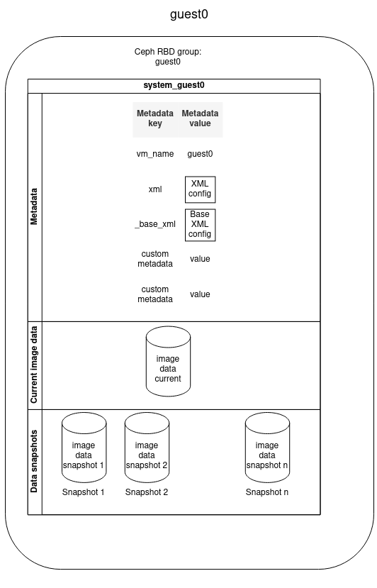
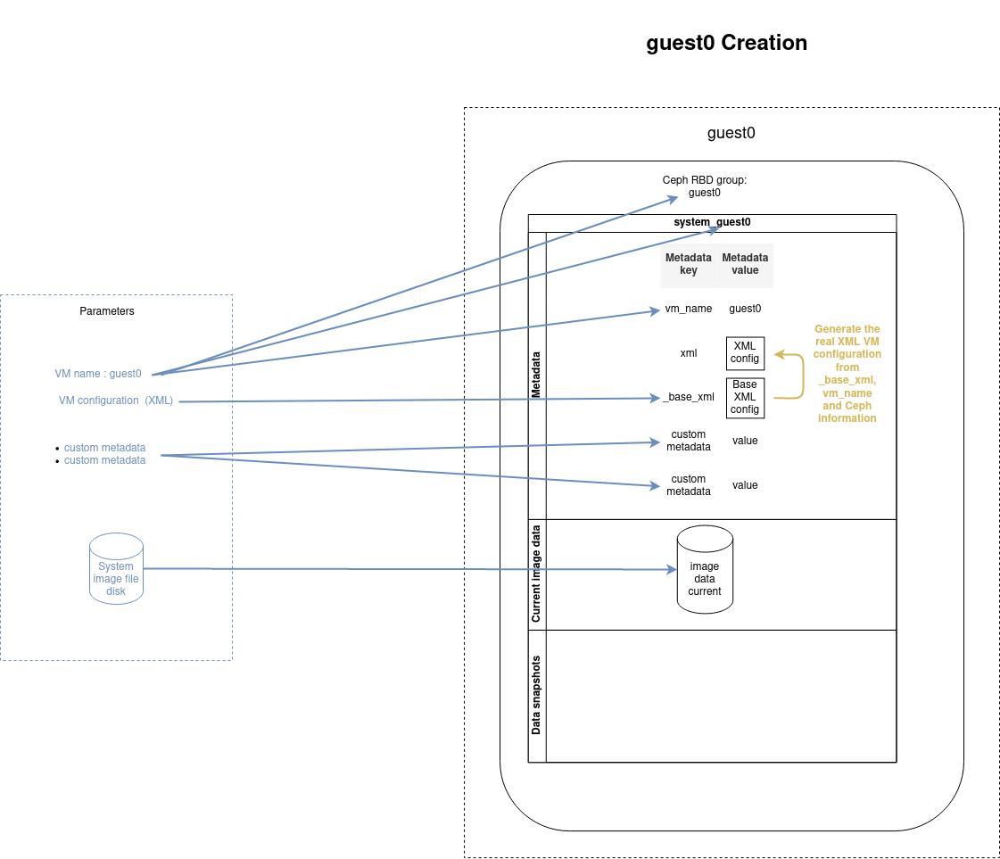
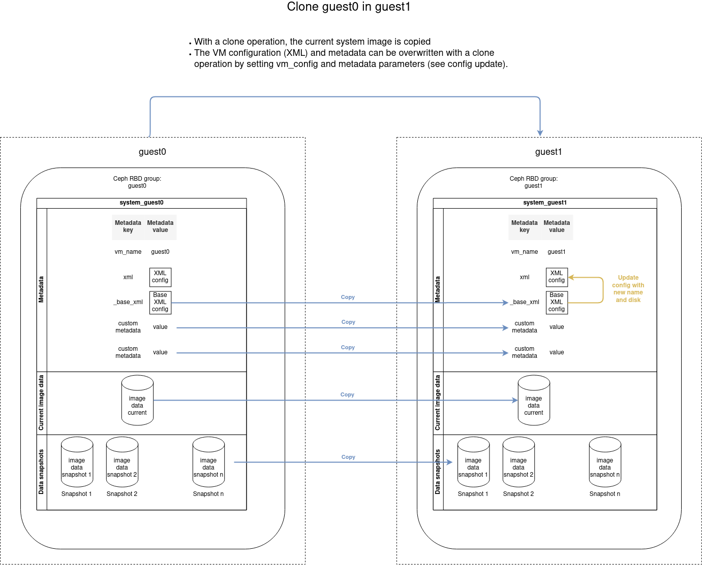

[Deploy your application on SEAPATH](../../Deploy%20your%20application%20on%20SEAPATH.md) > [Deploying virtual machines](../Deploying%20virtual%20machines.md)

# The vm\_manager tool

The [vm\_manager](https://github.com/seapath/vm_manager) tool is a high-level interface of pacemaker and Ceph to manage the VM like a resource.

For the full CLI and Python API reference, see [vm_manager Sphinx documentation](../../../_generated/upstream/vm-manager/sphinx-documentation.md).

Deploying a virtual machine on a SEAPATH cluster requires to handle many elements: ceph, qemu, libvirt, corosync. vm\_manager was created as a wrapper around these components.

> [!IMPORTANT]
> vm\_manager can also be used in standalone mode. In that case, it is basically a wrapper around Libvirt

This section describes the VM architecture from a high-level point of view. It also embed example playbooks from the `cluster_vm` ansible module, which is simply a wrapper around vm\_manager. Full documentation of `cluster_vm` is available on <https://galaxy.ansible.com/ui/repo/published/seapath/ansible/content/module/cluster_vm/>

You will also find information on how to troubleshoot problems related to VM management on the last section of the page.

## VM status

In the SEAPATH cluster the VMs can have several statuses:

- *Undefined*: The VM does not exist yet.
- *Disabled*: The VM exists and its data disk has been created, but it is not enabled to be used on the cluster.
- *Starting*: The VM is enabled and performing an operation of start.
- *Started*: The VM is enabled and started. *Note: This doesn’t mean that the VM is ready and has finished booting, which can take some time*.
- *Stopping*: The VM is enabled and performing a power-off action.
- *Stopped*: The VM is enabled and stopped.
- *Failed*: The VM is enabled, but it has failed to start.

## VM Manager commands

> [!IMPORTANT]
> On a SEAPATH machine, list all the vm\_manager commands with `vm-mgr --help`  
> The documentation for a single command can be displayed with `vm-mgr <command> --help`

All sub-commands has `-n`, `--name` required option to specify which resource should be used.

- `add_colocation`: Adds a colocation constraint between resources
- `clone`: Creates a copy of the VM
- `create`: Generates a new resource from a VM
- `create_snapshot`: Creates a snapshot of a resource
- `disable`: Stops and removes the resource on the cluster
- `enable`: Adds and starts the resource on the cluster
- `get_metadata`: Gets a metadata of a resource
- `list`: Lists all resources
- `list_metadata`: Lists all keys of a resource
- `list_snapshots`: Lists all created snapshots
- `purge`: Deletes all snapshots of a resource
- `remove`: Removes the resource
- `remove_snapshot`: Removes a snapshot of a resource
- `rollback`: Rollbacks to a snapshot for a resource
- `set_metadata`: Sets a metadata of a resource
- `start`: Start a resource
- `status`: Gets the status of a resource
- `stop`: Stops a resource
- `console`: Get access to the console of a VM on the cluster

## VM architecture

The diagram below describes how a VM is stored in the SEAPATH cluster. All non-volatile VM data is stored using Ceph, which is in charge of the maintenance of the data-store and data replication between all the hypervisors.

- VM is stored in a Ceph RBD group named as the VM name
- VM contains:

  - Metadata
  - Image data disk
  - Image data snapshots

Metadata provides information associated with a VM. It consists of a list of pairs (key, value) that are set at the moment of the VM creation. You can define as many metadata fields as you want but some keys are reserved:

|  **KEY**      |  **VALUE MEANING**                                                                                     |
|:--------------|:-------------------------------------------------------------------------------------------------------|
| *vm\_name*    | VM name                                                                                                |
| *\_base\_xml* | Initial Libvirt XML VM configuration                                                                   |
| *xml*         | Libvirt XML file used for the VM configuration. It is autogenerated by modifying the \_base\_xml file. |



## VM deployment

The VM data disk is set when creating a new VM or cloning an existing one, as described in the schemas below.

### Create a VM

Create a VM from scratch by importing an image disk with the *create* command:



```java
- name: Create and start guest0
  cluster_vm:
    name: guest0
    command: create
    system_image: my_disk.qcow2
    xml: "{{ lookup('file', 'my_vm_config.xml', errors='strict') }}"

```

### Clone a VM

Copy an existing VM with the *clone* command:



```java
- name: Clone guest0 into guest1
  cluster_vm:
    name: guest1
    src_name: guest0
    command: clone
```

## vm\_manager REST API

A REST API is available to get information and control vm\_manager

It is managed through a combination of `nginx` as a reverse proxy and `gunicorn` as the WSGI HTTP server.

An Ansible role provisions the API interface by generating or installing TLS certificates under `/var/local/vmmgrapi/certs/`. If custom certificates are not provided via `vmmgr_http_tls_crt_path` and `vmmgr_http_tls_key_path`, a self-signed certificate is automatically created using OpenSSL with a 4096-bit RSA key and a 25-year validity period.

To manage the application server, `gunicorn.socket` and `gunicorn.service` systemd unit files are installed. The socket-activated service is enabled and started, allowing on-demand launching of the Gunicorn workers.

In clustered environments, the role additionally configures the Pacemaker CRM to manage a virtual IP (`ClusterIP`) and the `nginx.service` as a clustered resource.

This REST API can be deployed with the `seapath_setup_vmmgrapi.yaml` playbook

More information in the [role documentation page](https://galaxy.ansible.com/ui/repo/published/seapath/ansible/content/role/vmmgrapi/).

### REST operations

Four operations are available on the vm\_manager REST API

`/` : List the VMs deployed on the standalone machine or cluster

`/status/<vm_name>`: Return the status of vm\_name. Read all possible status at [The vm_manager tool](The%20vm_manager%20tool.md)

`/start/<vm_name>`: Start vm\_name

`/stop/<vm_name>`: Stop vm\_name

# Troubleshooting

This section describes the unstable scenarios that can occur while executing Ansible commands on the cluster and which operations should be performed to recover a stable situation.

## Ansible command is interrupted

The execution of a *cluster\_vm* command can be interrupted for different reasons: crash on the hypervisor, network failure, manual stop of the operation… For the commands that modify the system, the interruption might result in an undesirable scenario, where a fix action will be required:

|  **Command**       |  **How to fix**                                                                                                                                                                                   |
|:-------------------|:--------------------------------------------------------------------------------------------------------------------------------------------------------------------------------------------------|
| create             | Re-call the command with the *force* parameter set to *true*.                                                                                                                                     |
| clone              |                                                                                                                                                                                                   |
| remove             | Re-call the command.                                                                                                                                                                              |
| start              |                                                                                                                                                                                                   |
| stop               |                                                                                                                                                                                                   |
| create\_snapshot   |                                                                                                                                                                                                   |
| rollback\_snapshot |                                                                                                                                                                                                   |
| remove\_snapshot   |                                                                                                                                                                                                   |
| enable             |                                                                                                                                                                                                   |
| disable            |                                                                                                                                                                                                   |
| purge\_image       | Note: purging snapshots according to number or date is not transactional. In case of interruption only a part of them might be removed. In this case, it is necessary to re-call the transaction. |

## VM cannot be enabled

Enabling a VM on the Pacemaker cluster might fail if its XML configuration is invalid. Pacemaker will detect it and the VM will remain in a *Stopped* or *Failed* state, triggering a *Timeout* error. The commands that can enable a VM are:

|  **Command**       |  **How to fix**                                                       |
|:-------------------|:----------------------------------------------------------------------|
| create             | Remove the VM  (\*), fix the configuration and try creating it again. |
| clone              |                                                                       |
| rollback\_snapshot |                                                                       |
| enable             |                                                                       |

(\*) Note: Calling the *create* or *clone* commands with the *force* parameter set to *true* will automatically remove the VM before its creation.

## “VM is not on the cluster” error

If the VM is not enabled on the Pacemaker cluster there are three commands that will fail with the *“VM is not on the cluster”* error.

|  **Command**    |  **Error message**        |  **How to fix**                                  |
|:----------------|:--------------------------|:-------------------------------------------------|
| start           | VM is not on the cluster. | VM has to be created and enabled on the cluster. |
| stop            |                           |                                                  |
| disable         |                           |                                                  |

## Unnecessary action / accessing nonexistent VM, snapshot or metadata

Creating a VM or snapshot that already exists or trying to access a nonexistent VM, snapshot or metadata will fail according to the following errors:

|  **Command**       |  **Error message**                       |  **How to fix**                        |
|:-------------------|:-----------------------------------------|:---------------------------------------|
| create             | VM already exists.                       | Choose a nonexistent VM *name*.        |
| clone              | VM already exists.                       | Choose an nonexistent VM *name*.       |
|                    | Error opening image.                     | Choose an existent VM *name*.          |
| remove             | VM does not exist.                       | Choose an existing VM *name*.          |
| list\_snapshots    | Error opening image.                     | Choose an existing VM *name*.          |
| create\_snapshot   | Error opening image.                     | Choose an existent VM *name*.          |
|                    | Snapshot already exists.                 | Choose a nonexistent *snapshot\_name*. |
| rollback\_snapshot | Error opening image.                     | Choose an existent VM *name*.          |
|                    | Snapshot does not exist on VM.           | Choose an existent *snapshot\_name*.   |
| remove\_snapshot   | Error opening image.                     | Choose an existent VM *name*.          |
|                    | Error checking if snapshot is protected. | Choose an existent *snapshot\_name*.   |
| purge\_image       | Error opening image.                     | Choose an existent VM *name*.          |
| get\_metadata      | Error opening image.                     | Choose an existent VM *name*.          |
|                    | No metadata for image.                   | Choose an existent *metadata\_name*.   |

## Invalid parameter name

Names for VMs, snapshots and metadata keys must only contain letters and numbers without spaces. Additionally, metadata has also reserved keys that cannot be used. In case of not following these rules, the commands *create*, *clone* and *create\_snapshot* will fail with the error *“Parameter must not contain spaces or special chars”*.

|  **Command**     |  **Error message**                                   |  **How to fix**                                                               |
|:-----------------|:-----------------------------------------------------|:------------------------------------------------------------------------------|
| create           | Parameters must not contain spaces or special chars. | Verify VM *name* and metadata *keys*.                                         |
| clone            |                                                      | Verify VM name and metadata keys (*src\_name* and *name* cannot be the same). |
| create\_snapshot |                                                      | Verify *snapshot\_name*.                                                      |
