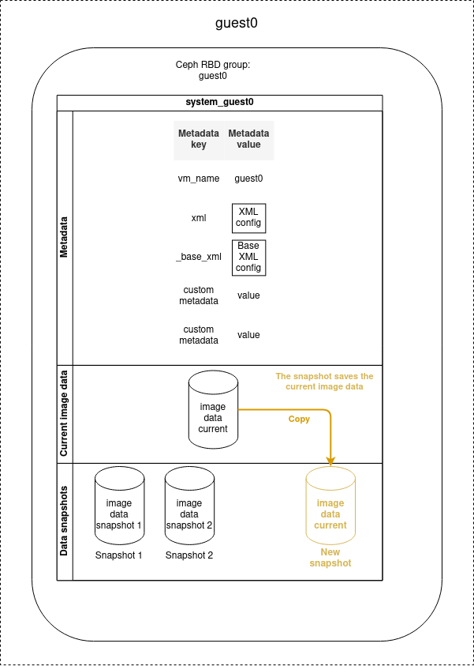
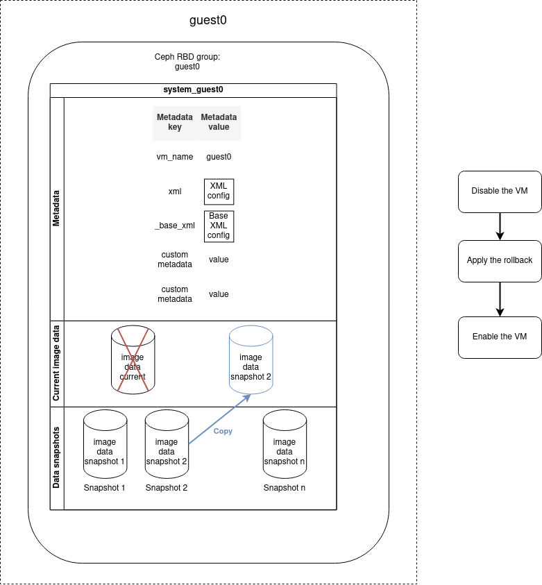
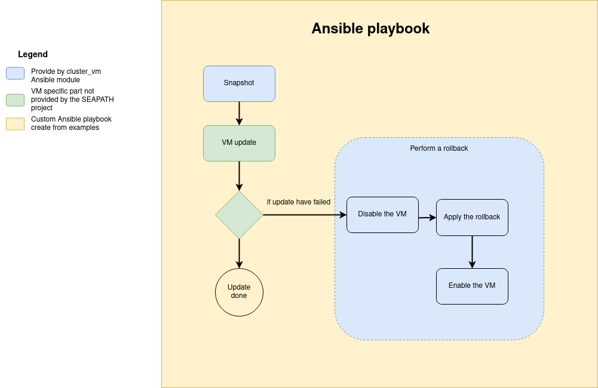
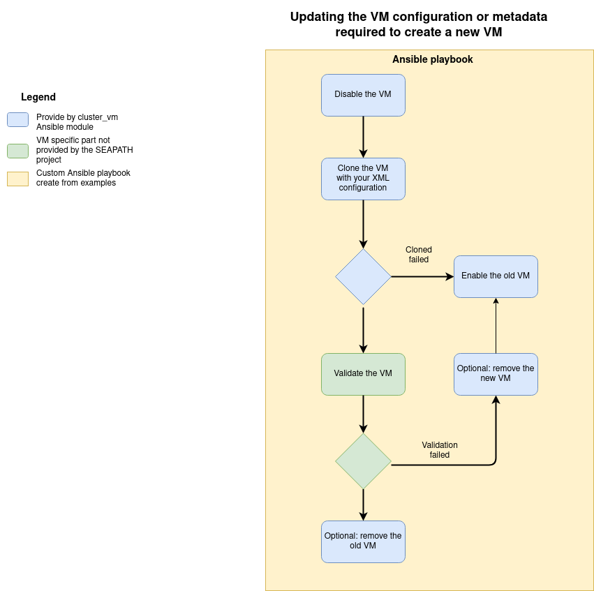

[Deploy your application on SEAPATH](../../Deploy%20your%20application%20on%20SEAPATH.md) > [Deploying virtual machines](../Deploying%20virtual%20machines.md)

# Update a virtual machine

This page explain scenarios to update a virtual machines. It explains how update is handled by vm\_manager and gives example playbook using the `cluster_vm` ansible module.

More information on vm\_manager at [The vm_manager tool](The%20vm_manager%20tool.md)

Full documentation of `cluster_vm` on the [role documentation page](https://galaxy.ansible.com/ui/repo/published/seapath/ansible/content/module/cluster_vm/).

## VM snapshots

Disk snapshots can be used to save the disk image data at a given moment, that can be later recovered.

### Snapshot creation

Snapshots can be created when the VM is stopped or running, but if you perform a snapshot when the VM is running, only the data written on the disk will be saved.

> [!IMPORTANT]
> Volatile data such as the content of the RAM or the data not written on the disk will not be stored on the snapshot.



```java
- name: Create a snapshot of guest0
  cluster_vm:
    name: guest0
    command: create_snapshot
    snapshot_name: snap1
```

### Snapshot rollback

You can restore the VM to a determined previous state by performing a rollback operation based on a snapshot. The data saved during the snapshot operation will be restored and replace the current disk image data. All current disk image data will be lost. The rollback operation does not remove the snapshot, it is possible to reuse the snapshot to re-apply a later rollback.

The rollback operation must be applied on a disabled machine. So if the VM is enabled, it will be automatically disabled before the rollback and re-enabled once the operation is finished.



```java
- name: Rollback VM guest0 to snap0
  cluster_vm:
    name: guest0
    command: rollback_snapshot
    snapshot_name: snap0
```

### Other snapshot operations

With the *cluster\_vm* module it is also possible to:

- List all snapshots
- Remove a particular snapshot
- Remove multiple snapshots by purging:

  - All of them
  - The *n* oldest one
  - The oldest ones to a specific date

An example playbook that removes the snapshots created before a determined date would be:

```java
# Example - Remove old snapshots
- name: Remove snapshots of guest0 older than January 24th 2021 8:00 AM
  cluster_vm:
    name: guest0
    command: purge_image
    purge_date:
      date: '2021-01-24'
      time: '08:00'
```

The purge operation can be performed regularly to avoid over space. This can be easily done with a tool like [Ansible Tower](https://www.ansible.com/products/tower) or [AWX](https://github.com/ansible/awx).

## Update a VM

### Updating the VM data inside the VM

Updating the VM data cannot be performed by the *cluster\_vm* module, but you can use its snapshot system to cancel the update in case of error as described in the diagram below. To achieve this, you can base your playbook on the below example.


> [!WARNING]
> If in a cluster, remember that no disk part must be present on the new Libvirt XML. This is entirely handled by vm\_manager.

```java
- name: "Prepare the VM update"
  hosts: "{{ groups.hypervisors[0] }}"
  tasks:
      - name: Stop vm  # First disable the vm01
        cluster_vm:
            name: vm
            command: stop
      - name: "Perform a snapshot"
        cluster_vm:
            name: vm
            command: create_snapshot
            snapshot_name: snap0
      - name: Restart vm
        cluster_vm:
            name: vm
            command: start

- name: Apply the update
  hosts: vm
  tasks:
    # TODO. Not handled by SEAPATH

# If the test has failed rollback to the previous snapshot
- name: Rollback to previous snapshot
  hosts: "{{ groups.hypervisors[0] }}"
  tasks:
      - name: "Remove vm02"
        ignore_errors: true
        cluster_vm:
            name: vm
            command: rollback_snapshot
            snapshot_name: snap0
        when: vm_update.rc != 0 or vm_test.rc != 0
```

### Updating VM configuration or metadata

The VM configuration and metadata are immutable. To change them, you must create a new VM from the existing one with the *clone* command.

Below is an example to help you to create a playbook to achieve this operation according to the following diagram.



```java
- name: Clone vm01 into vm02 with a new configuration
  hosts: "{{ groups.hypervisors[0] }}"
  tasks:
      - name: disable vm01  # First disable the vm01
        cluster_vm:
            name: vm01
            command: disable
      - name: "Clone vm01 into vm02 and update its configuration"
        block:
            cluster_vm:
                name: vm02
                command: clone
                src_name: vm01
                xml: "{{ lookup('file', 'new_config.xml', errors='strict') }}"
                metadata:  # You can add, remove or update metadata
                    newMetadata: "my_value"
                    removedMetadata: ""
                    existingMetadata: "my_value"
        # If the clone has failed remove the VM and re-enable vm01
        rescue:
            - name: "Remove vm02"
              ignore_errors: true  # It is possible that vm02 does not exist
              cluster_vm:
                  name: vm02
                  command: remove
            - name: "Restaure vm01"
              cluster_vm:
                  name: vm01
                  command: enable

- name: Test the new VM is ok
  hosts: vm02
  tasks:
      # TODO. Not handled by SEAPATH

# If the test has failed restore the vm01
- name: Restore vm01
  hosts: "{{ groups.hypervisors[0] }}"
  tasks:
      - name: "Remove vm02"
        ignore_errors: true
        cluster_vm:
            name: vm02
            command: remove
        when: vm_online.elapsed >= 150 or result.rc != 0
      - name: "Restaure vm01"
        cluster_vm:
            name: vm01
            command: enable
        when: vm_online.elapsed >= 150 or result.rc != 0

# If the test is ok, you can remove vm01
- name: Remove vm01
  hosts: "{{ groups.hypervisors[0] }}"
  tasks:
      - name: "Remove vm01"
        cluster_vm:
            name: vm01
            command: remove
        when: vm_online.elapsed < 150 or result.rc == 0
```
