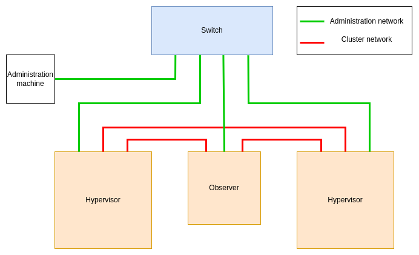

[Getting started](../../Getting%20started.md) > [Quick start](../Quick%20start.md)

# Wire and connect to the machines

Now that the necessary machines are flashed, they need to be accessed with SSH before launching the Ansible setup.

Each machine will need

- To be accessible by the administration machine running Ansible
- To receive PTP frames
- To be wired together (only for cluster setup)

# Access the machine with SSH

> [!NOTE]
> If you already know IT, you can use your preferred method to set up the IP of the machines (DHCP, static IP …). Just verify that you can access all machines through SSH, and you can skip this section.

### Wire the machines

Wire all your SEAPATH machines to the administration switch using Ethernet cables

Connect your Administration machine to the same switch

### Configure IP addresses

Connect a screen and a keyboard to the SEAPATH machine, and log into it

> [!IMPORTANT]
> On a freshly deployed SEAPATH, you can connect with
>
> - user: `admin` ; password: `seapath` on Debian
> - user `emergadmin` ; password: `emergadmin` on Yocto  
>   Be careful that the login prompt asks you to change the password. Re-enter the same `emergadmin` password again and type your new password twice.

Once logged in, give an IP address to the machine with the command

```java
sudo ip addr add <ip_addr>/24 dev <interface>
```

> [!IMPORTANT]
> The interface to choose depends on your hardware. You can search for the connected interfaces with the `ip a` command. Only one interface should be marked as `LOWER_UP`, this is the interface where you plugged your Ethernet cable.

> [!IMPORTANT]
> The network address to choose depends on your network configuration. If you are in a lab, with a separated network, you can choose a default address like `192.168.2.11/24`

If not already done, give an address to your administration machine in the same subnet. For example, `192.168.2.10/24`

### SSH into the machine

Verify that you can access all hypervisors. From the administration machine :

```java
ssh admin@<hypervisor_IP>
```

> [!IMPORTANT]
> If you are using SEAPATH pre-build images, included in the installer, you must download the associated [SSH private key file](https://releases.seapath.org/builds/v2.0.0/seapath-v2.0.0-artifacts-key) from the release and put it in your `~/.ssh/` folder.
>
> The ssh private key file must have the 0600 mode for security reason. Run the following command to ensure that:
>
> `chmod 0600 ~/.ssh/seapath-*-key`

> [!NOTE]
> If you are in a cluster setup, repeat this process on each hypervisor. The IP addresses must be different but within the same network, ex :
>
> - 192.168.2.11/24
> - 192.168.2.12/24
> - 192.168.2.13/24

# Wire the PTP network

Connect all the SEAPATH machines to your PTP setup using Ethernet cables.  
The interface of the hypervisor must be compatible with hardware PTP.

# Wire the cluster

This section only concerns the cluster setup.

Connect all cluster machines together using Ethernet cables. This should form a triangle connection, as shown on the schema below.


