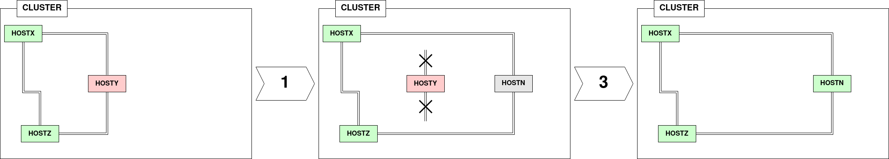

[SEAPATH fundamentals](../../SEAPATH%20fundamentals.md) > [High availability cluster](../High%20availability%20cluster.md)

# Cluster maintenance

# Node replacement

In case one of the nodes suffers a difficult to repair situation (lost motherboard for example, or lost disk with no RAID), it might become necessary to replace the server with a blank one.

From the cluster point of view, we will need to remove the old node and add the new one, for both corosync/pacemaker and ceph.

1. The `ansible/playbooks/replace_machine_remove_machine_from_cluster.yaml` playbook can remove a node from the cluster. For this, the `machine_to_remove` should be set to the hostname to remove.  
   The below command should be launched in the [ansible](https://github.com/seapath/ansible.git) project.

   ```bash
   cqfd run ansible-playbook -i /path/to/inventory.yaml -e machine_to_remove=HOSTNAME playbooks/replace_machine_remove_machine_from_cluster.yaml
   ```
2. A new host should be installed with the ISO installer and the same hostname, ip address, etc... than the old node.
3. Make the "cluster network" connections between hosts.
4. Restart the `seapath_setup_main.yaml` playbook to configure the new host in the cluster..



# Node disable

If a maintenance is needed on a specific node of the cluster, the deployed resources needs to be migrated to avoid any downtime.

To do so, the concerned node can be temporary disable from the cluster using:

```java
crm node standby <MACHINE_HOSTNAME>
```

Once the node is disabled, all the deployed resources are migrated to another cluster node, if applicable.

# Node update

If a node of the cluster needs to be updated, you can use the following Ansible playbooks:

- On SEAPATH Yocto:

```java
cqfd run ansible-playbook -i <YOUR_INVENTORY> playbooks/seapath_update_yocto_cluster.yaml
```

Note: You will need to generate first a SWU update file, and provide it in the `swu_images` directory of your Ansible working directory.

- On SEAPATH Debian:

```java
cqfd run ansible-playbook -i <YOUR_INVENTORY> playbooks/seapath_update_debian.yaml
```

> [!WARNING]
> Make sure to update **one node at a time**, and to wait for it to be back in the cluster before updating another one.
