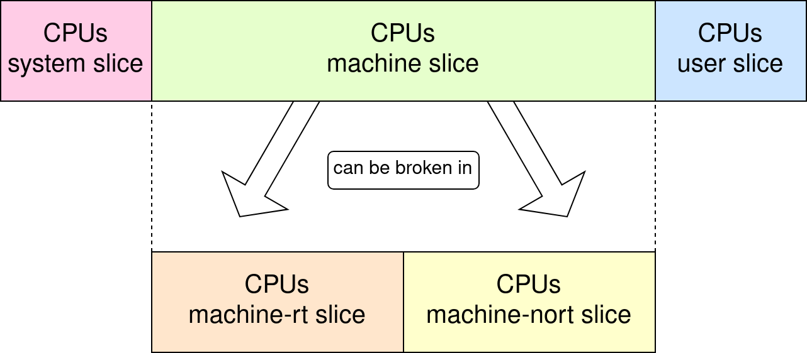

[SEAPATH fundamentals](../../SEAPATH%20fundamentals.md) > [Real-time](../Real-time.md)

# Real-time configuration

## **CPU isolation**

Isolated CPUs are meant to run only real-time virtual machines, as these will never be used by the hypervisor processes.

**On SEAPATH Yocto**, the configuration is done at compile time through the `SEAPATH_RT_CORES` variable in `seapath.conf`. See [SEAPATH parameters](https://github.com/seapath/yocto-bsp?tab=readme-ov-file#seapath-parameters) documentation on GitHub for more information.

**On SEAPATH Debian**, the configuration is done by Ansible, after flashing the image. The variable `isolcpus` is used and applied by the debian\_hypervisor role, included in the sepath\_setup\_main playbook. See the [role documentation](https://galaxy.ansible.com/ui/repo/published/seapath/ansible/content/role/debian_hypervisor/).

## **Finer control with cgroup (optional)**

### **Implementation in SEAPATH**

The Linux kernel uses [cgroups](https://docs.kernel.org/admin-guide/cgroup-v1/cgroups.html) in order to isolate processes. These cgroups work in a hierarchy where each layer restrains the resources a process can access. Systemd also uses this mechanism by grouping his processes in slices.

By default, service and scope units are placed in the system slice, virtual machines and containers are found in the machine slice, and user sessions are in the user slice (more details [here](https://www.freedesktop.org/software/systemd/man/systemd.slice.html)).

These slices can run on any cores of the hypervisor, but SEAPATH offers a way to restrict the CPUs where each of these slices can execute.

> [!IMPORTANT]
> This is configured using `cpusystem`, `cpumachines` and `cpuuser` in Ansible.

The project also defines 3 other slices (optional) to separate the functionalities:

- `machine-nort`: a subgroup of machine slice to run all virtual machines with the default scheduler.
- `machine-rt`: a subgroup of machine slice to run all virtual machines with real-time scheduler.
- `ovs`: a group to run Open VSwitch processes.

> [!IMPORTANT]
> These are configured by `cpumachinesnort`, `cpumachinesrt` and cpuovs in Ansible.

> [!WARNING]
> Because of the hierarchy, all CPUs used in machine-rt and machine-nort slices must also be used in the machine slice.

> [!IMPORTANT]
> Different slices can share the same CPUs. In a machine with few cores for example, it can be useful to put system, user and ovs slices on the same CPUs.

More information on the [debian\_hypervisor](https://galaxy.ansible.com/ui/repo/published/seapath/ansible/content/role/debian_hypervisor/) role.

### **Cgroups configuration**

Using these slices is useful to get a preset of CPU isolation for virtual machines. When placing a VM in either the machine-rt or machine-nort slice, it will be automatically scheduled on the CPUs of this slice.  
For example, it is particularly useful when deploying many VMs at once.

One really important thing to keep in mind when using these slices, is that the Qemu management threads of the virtual machines will be part of the machine slice (resp. machine-rt and machine-nort) and not the system slice. This means that these threads will not be executed in the CPUs associated with the Linux system but on the CPU chosen for the machine slice.

By activating CPU isolation on the machine slice, the management threads of the VM will be scheduled on the allowed CPU list of the slice. This new mechanism implies two things:

- You must have one more CPU on the machine-rt slice. Because every vCPU thread needs to be scheduled on its own CPU, one more is needed to schedule management threads.
- You must carefully place the management threads. By default, they will be scheduled on the first allowed CPU of the slice. If this CPU also runs an RT vCPU thread, it will prevent the management thread from running and the VM will never boot.

> [!IMPORTANT]
> The management thread scheduling is handled by the `emulatorpin` field in Libivrt XML.

For more information, read the page [Real time virtual machine configuration](../../Deploy%20your%20application%20on%20SEAPATH/Deploying%20virtual%20machines/Virtual%20machines%20deployment/Real%20time%20virtual%20machine%20configuration.md)
