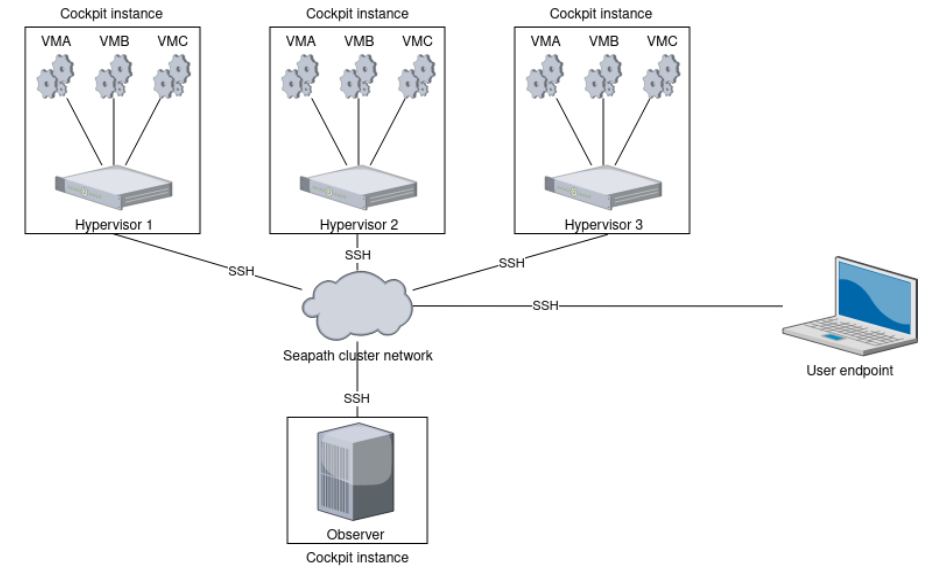
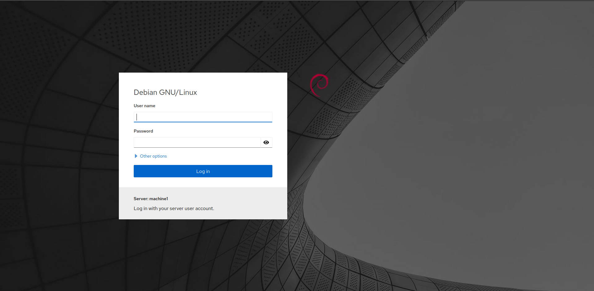
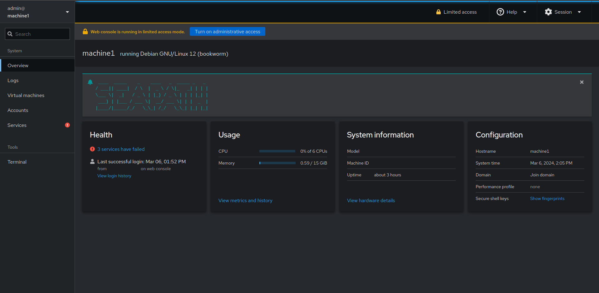
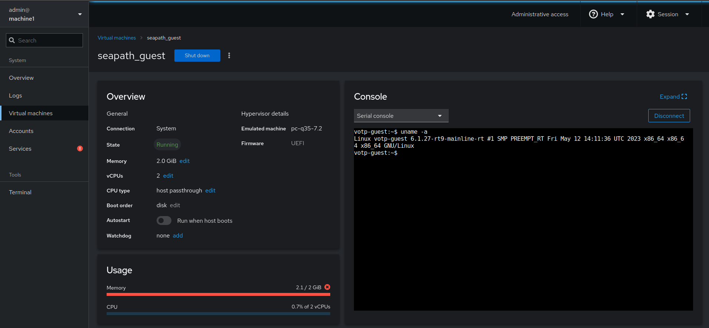
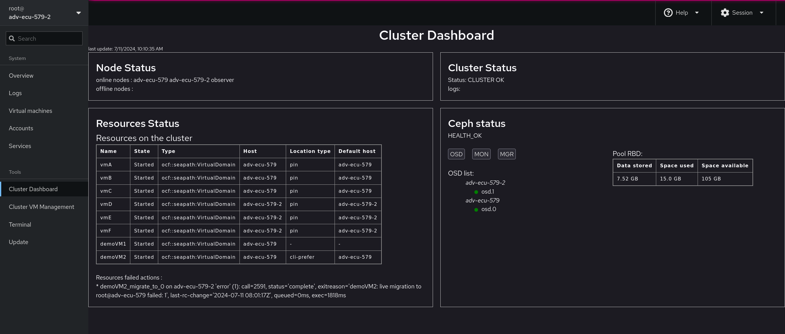
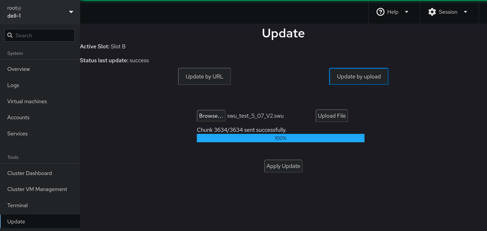
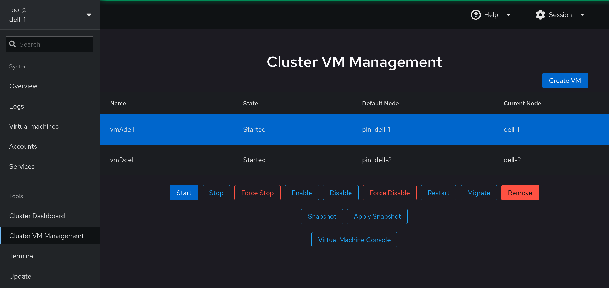
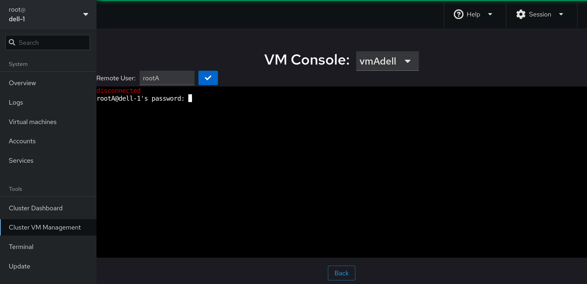

[SEAPATH fundamentals](../../SEAPATH%20fundamentals.md) > [Supervision](../Supervision.md)

# Using a graphical interface on Seapath

Seapath is designed to be used shell based terminal and don’t provide any graphical or modern graphical desktop environment such as Gnome/KDE. However, it is possible to manage a cluster using a web UI interface, such as Cockpit.

# Cockpit in SEAPATH

## What is Cockpit?

Cockpit is a web-based graphical interface designed to make server administration easier. It is capable, for example, in a fancy interface to:

- Inspect server logs
- Start containers and virtual machines
- Configure networks
- Access terminal
- Etc

The project is supported by RedHat, and is an active repository with 20K commits since 2013. It provides also a plugin system used to extend Cockpit functionalities.

Cockpit is packaged on both Yocto and Debian.

> [!IMPORTANT]
> For plugins hosted on a different repository from the main Cockpit repository, some of them are not yet packaged in Yocto.

Finally, note that Cockpit is not designed for massive deployment/configuration like Ansible does.

## Why using Cockpit in Seapath

Debugging each machine in a Seapath cluster can be tricky. Each machine is only accessible though CLI, and some tools used are not that simple to use (Libvirt, Ceph, etc.). Cockpit offers a way to simplify the use of Seapath by gathering all the administration and the monitoring in one place, for all cluster machines.

Keep in mind that Cockpit is an optional feature, and is a graphical abstraction of a shell based CLI. Everything that can be done in Cockpit can be achieve in a CLI.

## How does it work?

Cockpit is designed along a client/server schema. When using it on Seapath, one Cockpit instance is installed and running on each cluster machine. Cockpit used in back-end SSH protocol to dial with client and between each cluster cockpit instance. This implementation makes the use more secure, as Cockpit authentication inherits SSH and users configuration deployed on each machine. By doing so, it is easier to give access to Cockpit to only desired users.



## SEAPATH cockpit plugins

Three cockpit plugins where specifically developed for SEAPATH

- [cockpit-cluster-dashboard](https://github.com/seapath/cockpit-cluster-dashboard) To see the state of the SEAPATH cluster (ceph, pacemaker)
- [cockpit-update](https://github.com/seapath/cockpit-update) to update a SEAPATH Yocto hypervisor (for Debian update, refer to [Update a physical machine](../../Advanced%20configurations/Update%20a%20physical%20machine.md) )
- [cockpit-cluster-vm-management](https://github.com/seapath/cockpit-cluster-vm-management) To manage VMs over the SEAPATH cluster (start, stop, migrate …)

# Installation

### On Seapath Debian

Cockpit is packaged inside ISO image generated by build\_debian\_iso (<https://github.com/seapath/build_debian_iso/blob/main/srv_fai_config/class/99-seapath>), and is then installed with APT. Cockpit can be installed by adding the class `SEAPATH\_COCKPIT` to the list of classes in used, in `99-seapath` file: <https://github.com/seapath/build_debian_iso/blob/main/srv_fai_config/class/99-seapath>

On already set up machines it can be installed using apt:

```bash
sudo apt install cockpit cockpit-machines
```

> [!WARNING]
> Be careful to not install cockpit-network plugin, as it depend of network-manager package, which is not currently supported in Seapath.

The SEAPATH cockpit plugins must be installed using Ansible. On an already prepared SEAPATH Ansible repository, run

```java
cqfd run ansible-playbook -i <inventory> playbooks/seapath_setup_cockpit_plugins.yaml
```

If a “file not found” error appear, you should re run the preparation to download the plugins with `cqfd -b prepare`

### On Seapath Yocto

Cockpit can be installed in Seapath Yocto by adding it to the IMAGE\_INSTALL variable corresponding to the image you are building. For example, if you want to install it on host machines, you must add following lines in file sources/meta-seapath/recipes-core/images/seapath-host-common.inc:

```bash
IMAGE_INSTALL:append = " \
    cockpit \
    cockpit-dashboard \
    cockpit-ws \
    cockpit-bridge \
    cockpit-shell \
    cockpit-users \
    cockpit-systemd \
    cockpit-machines \
    cockpit-cluster-dashboard \
    cockpit-cluster-vm-management \
    cockpit-update \
"
```

This will install cockpit with the basic functionalities and 4 optional plugins (cockpit-machines, cockpit-cluster-dashboard, cockpit-cluster-vm-management, cockpit-update) as described below.

# Usage

Once Seapath is installed and configured on a Seapath machine, Cockpit is accessible through the interface connected to your network on the port 9090. It can be accessible in any web browser with the following URL: https://<TARGET\_IP>:9090/

> [!IMPORTANT]
> You can use the command netstat -tupn to identify the address in use to access to the Cockpit interface.

When connecting directly to a Cockpit instance, you are prompted to log in:



The credentials used to log in are the same as those configured on your Linux system.

> [!IMPORTANT]
> By default, for security reason it is not possible to log in using root user.

Once connected, the main menu of Cockpit presents an overview of the machine state:



For a simpler usage, we recommend to use a Cockpit instance hosted on a laptop or a VM, and connect it using Add new host menu entry to connect it to the different Cockpit instance of the Seapath cluster. By doing so, it is possible to gathered all Cockpit instance in one place, and to use one machine as a gateway.

#### Log inspection

This menu is a graphical abstraction of the journalctl command, and allows you to inspect logs of your machine along different filters (date, priority, etc).

#### Virtual machines

This menu allows you to manage virtual machines, such as:

- Creating a VM image from remote repository (Ubuntu, Fedora, etc), or import it from .qcow2 file
- Edit VM configuration (memory, CPU, machine type, network, etc)
- Access to VM though VNC or serial connection



#### Accounts

This menu is used to manage the users of your machine. Among accessible privileges, it is possible to:

- Add or delete users
- Give new privileges
- Force the use of a new password
- Etc

#### Services

This menu is used to manage the systemd services of your system, and offers same uses such as systemctl command.

#### Terminal

A simple bash terminal.

#### Cluster dashboard

This menu is used to have an overview of the cluster. It displays the following information:

- Status of the cluster nodes
- Status of the cluster
- List of Pacemaker resources deployed
- Status of the shared storage Ceph



#### Update

This menu can be used to update a SEAPATH Yocto hypervisor.

Plugin features:

- Fetch the swu image
- Perform the update using SWUpdate
- Reboot after update
- Get the status of the last update and the active slot



#### Cluster VM management

This menu lets you manage all VM in the cluster, unlike cockpit-machine, which has a local scope.

Plugin features:

- Create a VM

  - Using existing qcow2 and xml files
  - Uploading qcow2 and xml files
- Perform an action on a VM

  - Start
  - Stop / force stop
  - Enable
  - Disable / force disable
  - Restart
  - Migrate
  - Remove
  - Snapshot (create and apply)
  - Console access



## Cockpit and Cybersecurity

Even if Seapath provides a secure environment, adding Cockpit increase mechanically the attack surface of your system. As already said earlier, Cockpit is a graphical abstraction of the system CLI, and so, inherits from all Cybersecurity rules implemented.

It is important to mention that currently, there is no Cybersecurity hardening configured for Cockpit specifically.
