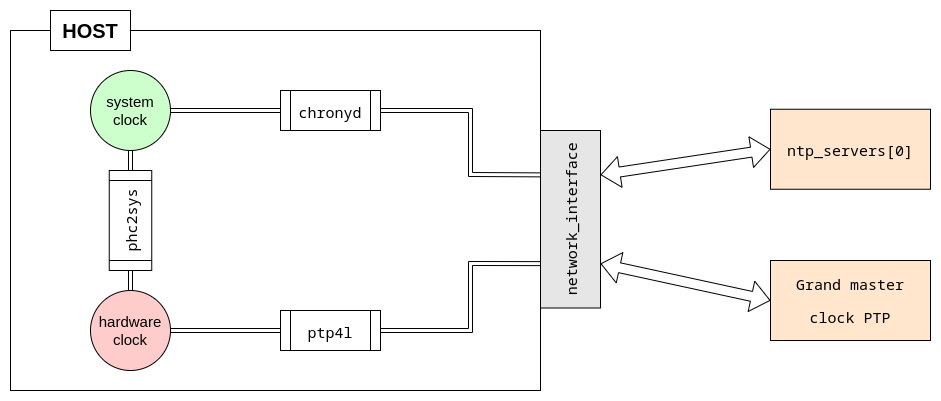

[SEAPATH fundamentals](../../SEAPATH%20fundamentals.md) > [Time Synchronization](../Time%20Synchronization.md)

# Time synchonization management

### Connectivity

The grand master clock and the physical machines are usually connected via an L2 network (consisting of PTP switches) to the GMC (Grand Master Clock).

PTP traffic is usually sent in a VLAN.

### Centralized Management with Timemaster

On a running SEAPATH host, time synchronization is controlled by `timemaster` (from the `linuxptp` package).  
It wraps three components:

- **chrony** – NTP client for the system clock.
- **ptp4l** – PTP client for the hardware clock.
- **phc2sys** – Keeps hardware and system clocks aligned.

`timemaster` can also run NTP by itself. With one configuration file you manage **PTP and NTP together** — no need to configure separate daemons.



### Configuration File

Main file:

```java
/etc/linuxptp/timemaster.conf
```

Key points:

- The **PTP settings** are defined in one or more `[ptp_domain X]` sections. This is where you tell `timemaster` which interfaces should join the PTP domain and what parameters to use.
- The **NTP settings** are defined in the `[chrony.conf]` section (or `[ntp.conf]` if you use `ntpd`). This is where you list your NTP servers and options.
- The IEC 61850 PTP profile isn’t a separate “profile” file — it’s achieved by setting the appropriate configuration items in `timemaster.conf` (announce interval, sync interval, delay mechanism, etc.).

### Service Management & Logs

- Only `timemaster` is enabled as a systemd service; `chronyd`, `ptp4l`, and `phc2sys` are **disabled** individually because `timemaster` starts and supervises them.
- Check logs and status with:

  ```java
  journalctl -u timemaster
  systemctl status timemaster
  ```

### Checking Current Synchronization

Because `timemaster` launches **chrony** under the hood, you can still use standard chrony commands to see the current state of synchronization.  
For example:

```java
chronyc sources
```

This shows which PTP or NTP source is currently selected, its offset, and how stable it is. It’s one of the fastest ways to confirm that time sync is working on a SEAPATH host.

### Example `timemaster.conf`

Below is a simplified IEC 61850-style configuration showing how PTP and NTP are defined in one file.

```java
# /etc/linuxptp/timemaster.conf

[ptp_domain 0]
# Interface(s) used for PTP
interfaces eno12419.800
# Optional NTP delay tweak for source selection:
ntp_poll 0
delay 1e-9

[timemaster]
ntp_program chronyd

# NTP configuration for chrony:
[chrony.conf]
include /etc/chrony/chrony.conf
server ntp.unice.fr iburst maxsamples 10 minsamples 10 maxpoll 6 minpoll 6
server 51.145.123.29 iburst maxsamples 10 minsamples 10 maxpoll 6 minpoll 6

# (If you prefer ntpd instead of chrony)
[ntp.conf]
includefile /etc/ntp.conf

# PTP client configuration (IEC 61850 profile)
[ptp4l.conf]
slaveOnly             1
network_transport     L2
delay_mechanism       P2P
domainNumber          0
logAnnounceInterval   0
logSyncInterval       0
logMinPdelayReqInterval 0
operLogPdelayReqInterval 0
announceReceiptTimeout   3
priority1             255
priority2             255
clockClass            248
tx_timestamp_timeout  10

# Paths to the daemons:
[chronyd]
path /usr/sbin/chronyd

[ntpd]
path /usr/sbin/ntpd
options -u ntp:ntp -g

[phc2sys]
path /usr/sbin/phc2sys

[ptp4l]
path /usr/sbin/ptp4l
options --step_threshold 0.00001 -l 4
```

## Troubleshooting

### rogue peer delay response

When a switch is used between PTP grand master clock and the hypervisors, if the timemaster service returns an error rogue peer delay response, this is probably because the switch doesn’t support peer-to-peer PTP.

This error is particularly visible in a cluster : Connecting only one hypervisor is successful, but connecting another one fails.

To correct this behavior, you can

- Connect the hypervisor and the grand master clock directly (without a switch)
- Use a PTP compliant switch
- Change the delay\_mechanism in the ptp4l configuration from P2P to E2E (end-to-end). Please be aware that this configuration is not the one required by IEC-61850, however, it can be useful for testing.
