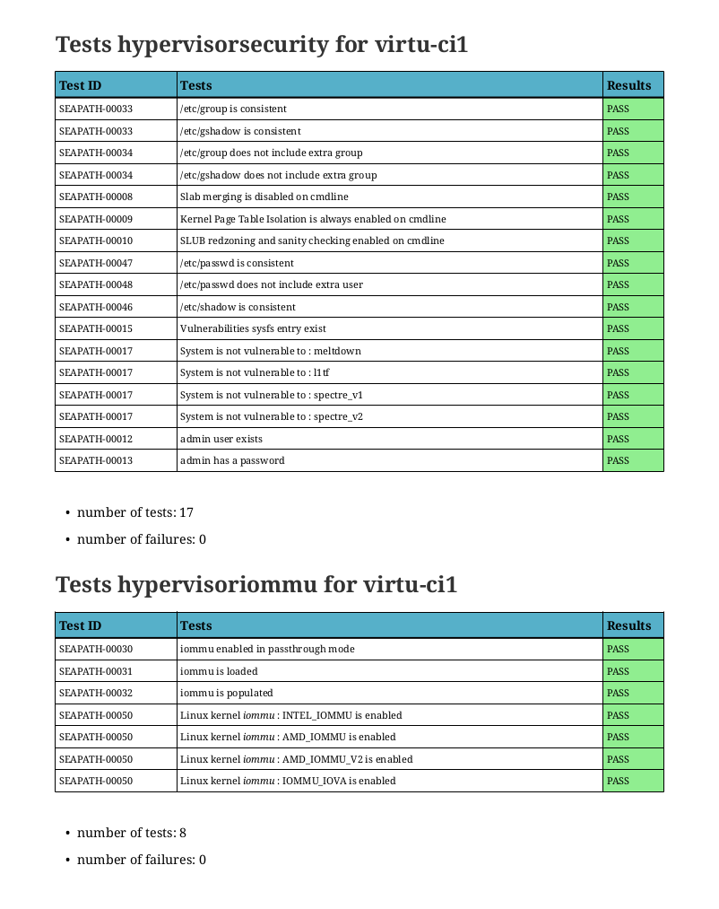
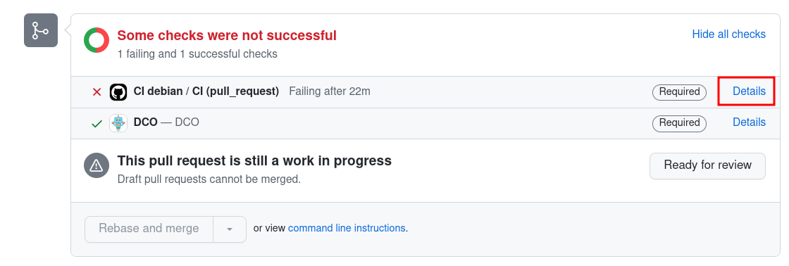
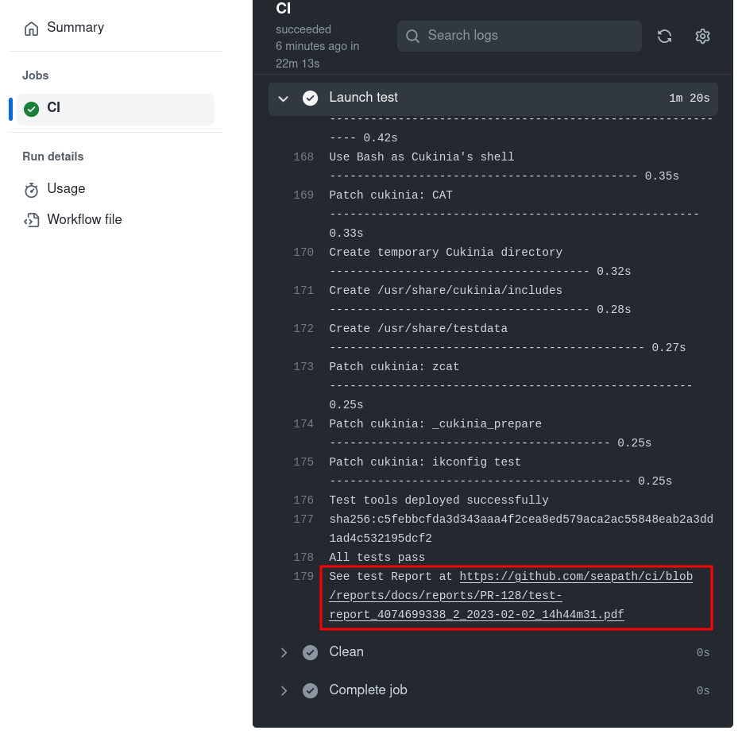
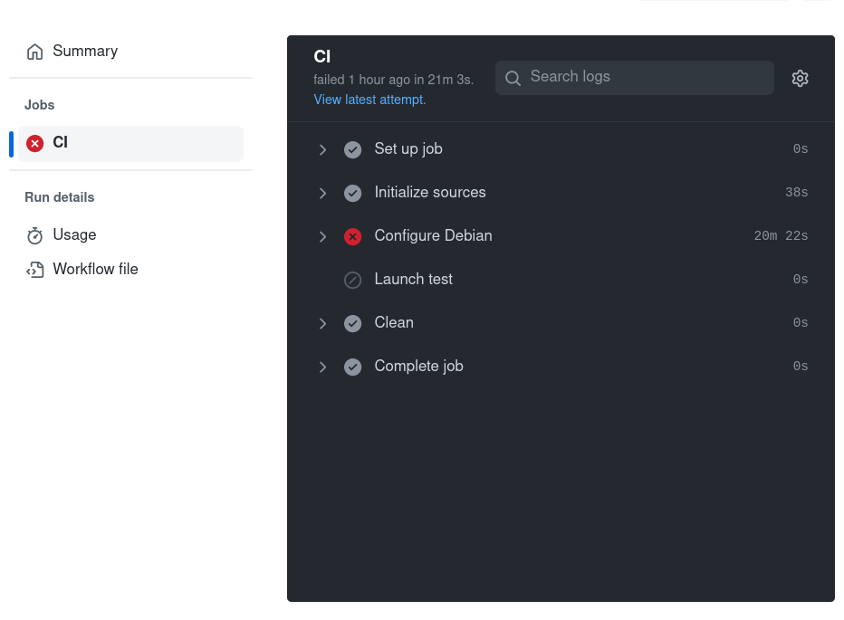
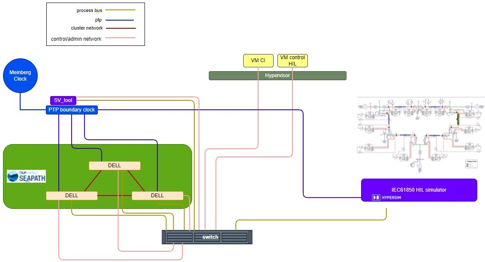

[Tests and CI](../Tests%20and%20CI.md)

# Continuous integration on SEAPATH

A continuous integration (CI) process has been implemented in order to deploy and test a custom cluster before merging any pull requests. Source code can be found in <https://github.com/seapath/ci>.

The CI is based on GitHub action and has been completely dockerized in order to guarantee its reproducibility and scalability.

## Description

The CI operate on a SEAPATH operating system. To avoid many problems, all machines are already flashed with SEAPATH and the CI will only configure the systems using the Ansible playbooks. This implies the iso creation and the boot process can't be tested.

All machines are linked to a self-hosted runner, on which the GitHub Action for the CI will run.

The CI job is divided into different stages :

- Fetch the sources of the pull request to test
- Launch the Debian configuration and hardening using Ansible playbooks
- Deploy Cukinia and launch tests
- Generate and upload the test report

### Tests

The CI use [Cukinia](https://github.com/savoirfairelinux/cukinia), a system-level validation framework as testing tool, all tests launched on Debian are available at <https://github.com/seapath/cukinia-tests/tree/main>.

The CI performed the following tests:

- check regression on SEAPATH Ansible configuration by calling these Ansible playbooks as it will be in a regular SEAPATH setting up
- functional system tests, which check the OS configuration to unsure all machines are well configured and there are no regression
- hypervisor tests, to verify we can deploy VMs on hypervisors
- cluster tests, to check the cluster are well setup and the share storage works
- security tests, to unsure security hardening is correctly applied
- network connections tests, which verify that all network interface and all network works by making connections among them
- Quick IEC 61850 Sample values receptions and latency measurement tests
- PTP tests, to verify PTP clock is well synchronized in the host and the VM

No Real-time, complex IEC 61850, complex cluster tests or long times latency tests are run on the CI for now. These tests are too long to be run on each GitHub pull request, so it is planned to integrate these tests at every release of the SEAPATH project.

### Report

The CI can fail in three ways :

- The configuration of SEAPATH  is wrong and the associated Ansible playbook fail
- The tests fail
- The tests on VM fail

The failure of the configuration can be observed in the CI logs.

After the configuration, all tests will be gathered in a test report. All the test contained in the report must pass for the pull request to be merged.

## Using the CI

The CI is actually running on the [debian-main](https://github.com/seapath/ansible/tree/debian-main) branch and on the [main](https://github.com/seapath/ansible) branch of the Ansible repository  
Every pull request needs to pass the tests to be merged.

After opening a pull request, wait for an approval of a member of SEAPATH. This will trigger the CI as a GitHub Action. The logs of the CI are visible on your pull request page, either in the "Conversation" tab or the "Checks" tab.  
All running actions are also visible in the Actions tab on the repository.

The complete CI takes about 15 minutes. At the end, the test report is available through a link given in the log of the GitHub Action, at the end of the step "Launch test" step.

Access the logs of the CI on the pull request "Conversation" tab

Location of the link of the test report

Ansible's configuration has failed, the tests were not launched, and the link was not given.

## Host your own CI

### Preparing a cluster

Hosting your own CI on SEAPATH first required having a cluster up and ready.

You need:

- a SEAPATH cluster (all instructions for cluster configuration can be found on the [SEAPATH architecture repository](https://github.com/seapath/seapath-architecture))
- a machine (or virtual machine) to host the GitHub runner
- a PTP clock
- a machine time synchronized with PTP clock with docker to host SV Tools (an IEC 61850 Sample Value simulator)

> [!IMPORTANT]
> IEC61850 HIL simulator is not needed because it is not used for the moment.

### Preparing the CI

The runner used to configure the machines will be used for the CI. Docker and [cqfd](https://github.com/savoirfairelinux/cqfd) are the only required software to launch it.

If you choose GitHub Actions to trigger the CI, you can follow [this guide](https://docs.github.com/en/actions/hosting-your-own-runners/adding-self-hosted-runners) to link your self-hosted runner with your repository. Otherwise, another trigger has to be configured for the chosen CI solution.

The CI script launched with the CI is launch.sh on the [SEAPATH CI](https://github.com/seapath/ci/blob/main/launch.sh) repository. It will have to be adapted to fit with your repository links and your inventories and keys on your runner.

This section will be expanded in the future for a better understanding.
