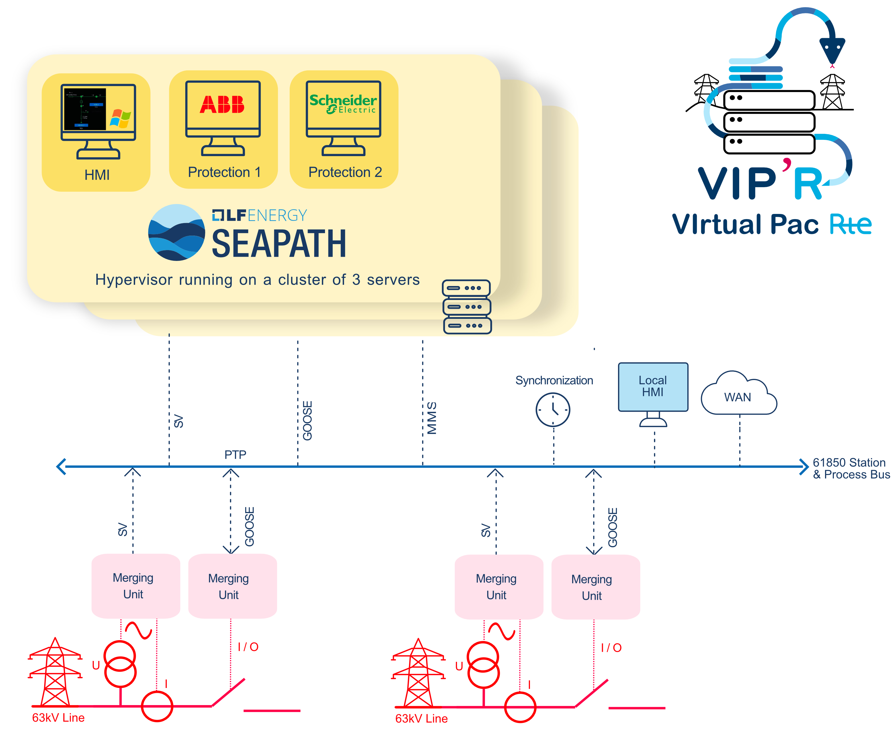

[Who is using SEAPATH ?](../Who%20is%20using%20SEAPATH%20_.md)

# RTE : VIP'R R&D Project - VIrtual PAC Rte

## **Overview**

The VIP’R project (Virtual PAC Rte) is a cutting-edge R&D initiative led by RTE, the French transmission system operator, as part of its broader digital transformation strategy. Building on the SEAPATH open-source virtualization platform, VIP’R aims to virtualize the most critical functions of substation automation: **protection systems**.

Following the successful virtualization of substation-level functions [RTE : R#SPACE Industrial Use Case of SEAPATH](RTE%20_%20R%23SPACE%20Industrial%20Use%20Case%20of%20SEAPATH.md) such as **HMI**, **Gateway**, and **Automatons**, VIP’R represents the next major step—demonstrating that even real-time protection functions can be reliably virtualized.

## **What is VIP’R?**

VIP’R is a research and development project designed to prove that **virtualized protection systems** can match or exceed the performance and reliability of traditional hardware-based systems. By the end of 2026, RTE plans to deploy and test virtual protection for a 63kV substation and its six line feeders at the Campus Transfo laboratory. This will be achieved using two virtual machines provided by ABB and Schneider Electric.

The goal is to validate that these centralized, virtualized protections can deliver the same level of **performance** and **availability** as the twelve physical protection devices currently used in substations. If successful, field testing in a real substation—operating in parallel with a conventional control system—is planned for 2027.

Beyond technical validation, VIP’R also aims to shift the industry paradigm. It encourages vendors to transition from hardware-centric business models to software-based solutions, fostering a new ecosystem of multi-vendor, open-source collaboration around SEAPATH.

## **Challenges**

Virtualizing protection functions presents several significant challenges:

- **Real-Time Performance**: Protection systems must process sampled data every **250 microseconds**, detect faults, and issue breaker commands—all within a strict **30ms** time window.
- **High Availability**: The system must maintain **>99.9% availability**, ensuring reliability equivalent to or better than traditional hardware.
- **Vendor Ecosystem Transformation**: The shift to virtualization requires suppliers to adapt their offerings and business models, moving from hardware to software solutions.
- **Technical Validation**: The project must validate the full virtualization architecture, including real-time data processing and interoperability across multiple vendors.
- **Cost Efficiency**: By enabling full virtualization, VIP’R supports RTE’s broader R#SPACE initiative, aiming to reduce the cost of digitalization.
